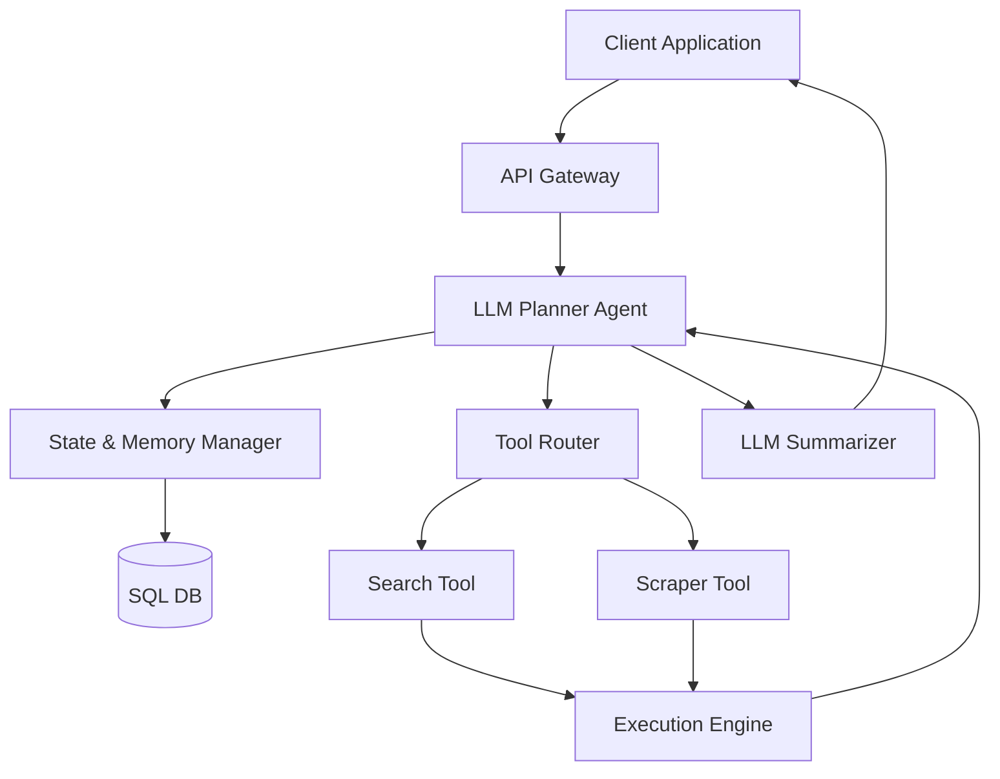
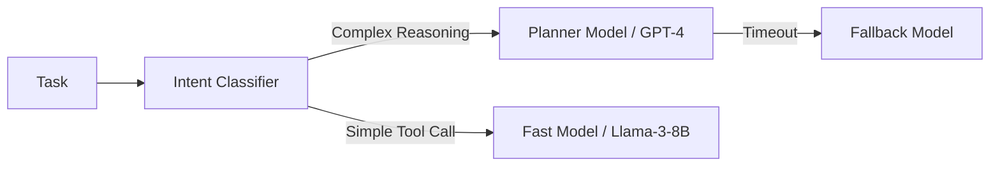

# Coach Answer: Agentic Workflow Orchestrator

> Type: GenAI High-Level Design  
> Difficulty: Advanced  
> Time Target: 45 minutes

---

## 1. 🎯 Requirements & Core Metrics

### Functional Requirements
- **Core Functionality:** The system must coordinate multiple LLM agents, tools, and long-term memory to solve complex, multi-step tasks.
- **Target Audience:** Internal employees automating complex reasoning and multi-step processes.
- **Key GenAI Features:** 
  - Dynamic tool routing and selection.
  - Multi-step reasoning with memory.
  - State machine transitions for workflow coordination.

### Non-Functional Requirements (NFRs)
- **High Availability:** 99.9% uptime.
- **Scalability:** Support 10,000 active workflow sessions.
- **Reliability:** Graceful error handling for LLM hallucination or tool failure.

### Out of Scope
- Detailed UI/UX design.
- Foundational model training.

---

## 2. 🧮 Back-of-the-Envelope Estimation

### Traffic & Scale
- **Daily Active Workflows:** 50,000.
- **Steps per Workflow:** ~10.
- **Tool Invocations per step:** ~2.
- **Total LLM Calls:** ~1M per day.

### Storage & Bandwidth
- **Tokens per Call:** 2000 input, 500 output.
- **Total Tokens:** ~2.5B tokens/day.
- **Cost:** (2.5B / 1K) * $0.01 average = $25,000/day.

---

## 3. 🔌 API Design

**Endpoint:** `POST /v1/workflow/execute`

**Request:**
```json
{
  "task": "Research competitor pricing and generate a report",
  "allowed_tools": ["search", "scraper", "calculator"]
}
```

**Response (SSE):**
```json
data: {"status": "running", "step": "search", "output": "Found 5 competitors"}
...
```

---

## 4. 💾 Data Model & Schema

**PostgreSQL (Workflow State):**
```sql
CREATE TABLE workflows (
    id UUID PRIMARY KEY,
    status VARCHAR(50),
    context JSONB,
    created_at TIMESTAMP DEFAULT NOW()
);
```

**Vector DB (Memory):**
- **Chunks:** `{ memory_id, embedding(1536), content }`

---

## 5. 🏗️ High-Level Architecture

### Architecture Diagram



### Data Flow
1. **Query Ingestion:** User provides a complex task.
2. **Planning:** LLM Planner Agent decomposes task into steps.
3. **Execution:** State Manager records plan. Router selects tools.
4. **Action:** Tools execute and return context.
5. **Observation:** Planner Agent observes results, adjusts plan.
6. **Completion:** Summarizer generates final output.

---

## 6. 🔍 Deep Dives — Classical

### 6.1 Scaling Strategy
- **Horizontal Scaling:** Stateless Planner and Executor nodes.
- **Database Scaling:** PostgreSQL master-replica for state.
- **Queuing:** Kafka for asynchronous task execution.

### 6.2 Caching Approach
| Cache Layer | What to Cache | TTL | Invalidation |
|-------------|---------------|-----|--------------|
| Tool Cache | Tool API responses | 1h | Expiry |
| State Cache | Active workflow context | 24h | Completion |

---

## 7. 🔍 Deep Dives — GenAI-Specific

### 7.1 🎯 Token & Context Budget Planning

**Context Window Allocation:**
```
┌─────────────────────────────────────────────┐
│           Context Window (8192 tokens)       │
├─────────────┬──────────┬─────────┬──────────┤
│System Prompt│ Tool Defs│  Memory │  Output  │
│ (500 tk)    │ (2000 tk)│(3000 tk)│ (2692 tk)│
└─────────────┴──────────┴─────────┴──────────┘
```

### 7.2 🔀 LLM Routing / Model Selection



### 7.3 🛡️ Safety / Moderation / Red-Teaming Hooks
- **Input Filters:** Prompt injection checks.
- **Output Filters:** Hallucination checks before tool execution (e.g., stopping the LLM from deleting database records if it hallucinated an SQL command).

### 7.4 📈 Evaluation and Feedback Loops
- **Offline:** LLM-as-a-judge evaluates planner reasoning trace.
- **Online:** Workflow completion rate, steps-to-completion, error rate.

---

## 8. ⚖️ Trade-offs

### Decision 1: ReAct vs Plan-and-Solve
| ReAct | Plan-and-Solve |
|-------|----------------|
| Pros: Dynamic, reactive to immediate tool output | Pros: Better for long-horizon tasks, less token-intensive |
| Cons: Can get stuck in loops | Cons: Struggles if early steps fail |
**Chose:** Hybrid. Plan-and-Solve for high-level, ReAct for micro-steps.

---

## 9. 🔮 Follow-up Questions

### Scaling Questions
- **What if traffic increases 10x?** Scale Executor nodes, use Kafka partitioning for higher throughput.


