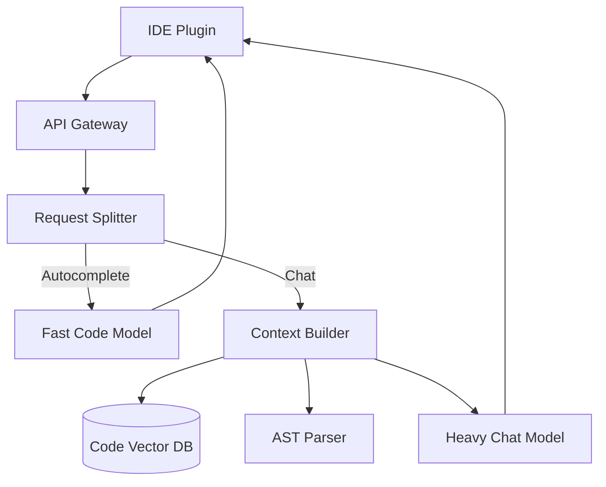
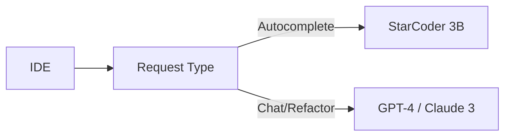

# Coach Answer: AI Coding Copilot

> Type: GenAI High-Level Design  
> Difficulty: Advanced  
> Time Target: 45 minutes

---

## 1. 🎯 Requirements & Core Metrics

### Functional Requirements
- **Core Functionality:** IDE-integrated AI assistant that provides code autocompletion, refactoring, and codebase-aware chat.
- **Target Audience:** Software Engineers.
- **Key GenAI Features:** 
  - Sub-second code completion.
  - Multi-file context awareness.
  - Explanation of complex code snippets.

### Non-Functional Requirements (NFRs)
- **High Availability:** 99.9% uptime.
- **Low Latency:** Code completion TTFT < 200ms.
- **Security:** Strict tenant isolation, no code retention for enterprise users.

---

## 2. 🧮 Back-of-the-Envelope Estimation

### Traffic & Scale
- **Daily Active Users:** 1M.
- **Completions per User:** 200/day.
- **Peak QPS:** ~5,000 QPS.

### Storage & Bandwidth
- **Tokens per Call:** 1000 input, 50 output (completion).
- **Cost:** High inference cost due to volume. Needs heavy caching and small models for completion.

---

## 3. 🔌 API Design

**Endpoint:** `POST /v1/copilot/complete`

**Request:**
```json
{
  "prefix": "def fibonacci(n):",
  "suffix": "",
  "language": "python",
  "file_path": "math.py"
}
```

---

## 4. 💾 Data Model & Schema

**Vector DB (Codebase Index):**
- **Chunks:** `{ chunk_id, file_path, embedding(1536), content }`

---

## 5. 🏗️ High-Level Architecture

### Architecture Diagram



### Data Flow
1. **Completion:** IDE sends prefix/suffix -> FastLLM -> Returns tokens.
2. **Chat:** IDE sends query -> Context Builder embeds query -> Retrieves relevant files/snippets -> HeavyLLM -> Returns response.

---

## 6. 🔍 Deep Dives — Classical

### 6.1 Scaling Strategy
- **Horizontal Scaling:** API and Inference nodes.
- **Edge Inference:** Run small completion models on local machines if possible, fallback to cloud.

### 6.2 Caching Approach
| Cache Layer | What to Cache | TTL | Invalidation |
|-------------|---------------|-----|--------------|
| Prefix Cache | Common imports/boilerplates | 24h | LRU |

---

## 7. 🔍 Deep Dives — GenAI-Specific

### 7.1 🎯 Token & Context Budget Planning

**Context Window Allocation (Code Chat):**
```
┌─────────────────────────────────────────────┐
│           Context Window (16384 tokens)      │
├─────────────┬──────────┬─────────┬──────────┤
│System Prompt│ File Ctx │  Chat   │  Output  │
│ (200 tk)    │(10000 tk)│(2000 tk)│ (4184 tk)│
└─────────────┴──────────┴─────────┴──────────┘
```

### 7.2 🔀 LLM Routing / Model Selection



### 7.3 🛡️ Safety / Moderation / Red-Teaming Hooks
- **Output Filters:** Check for leaked API keys in generated code.

### 7.4 📈 Evaluation and Feedback Loops
- **Online:** Acceptance rate of code completions (e.g., did the user hit Tab or Backspace).

---

## 8. ⚖️ Trade-offs

### Decision 1: FIM (Fill-in-the-Middle) vs Prefix-Only
| FIM | Prefix-Only |
|-----|-------------|
| Pros: Highly accurate context | Pros: Faster, simpler |
| Cons: Requires specialized training | Cons: Blind to upcoming code |
**Chose:** FIM for autocomplete to provide syntactically valid completions.

---

## 9. 🔮 Follow-up Questions

### Scaling Questions
- **How to handle a 10M line monorepo?** Use precise AST-based indexing and sparse retrieval (BM25) alongside dense embeddings, avoiding full-repo context loading.


