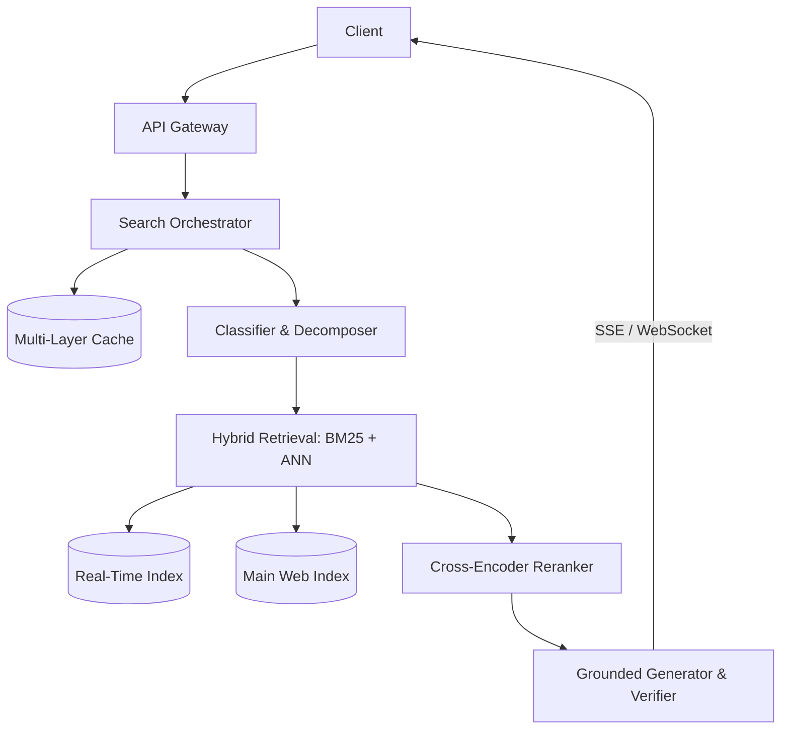

# Coach Answer: AI Search Engine

> Type: GenAI High-Level Design  
> Difficulty: Advanced  
> Time Target: 45 minutes

---

## Phase 1 — Framing & Scope (5 min)

Frame this as a multi-tenant, real-time answer engine pairing web-scale retrieval with grounded generation. Unlike a static knowledge assistant, freshness and verifiable inline citations are core requirements. Define the language model roles clearly: a lightweight model decomposes complex questions, a cross-encoder reranks candidate passages, and a stronger generator synthesizes a cited answer while streaming tokens incrementally.

Scope V1 to text search over web documents with inline Markdown citations and live streaming. Defer multi-modal synthesis, autonomous web actions, and long-term user profiles.

---

## Phase 2 — Requirements, Scale & Latency Budgets (5 min)

- **Functional:** Decompose multi-faceted queries into atomic sub-queries with temporal resolution ("last year" anchored to the current timestamp), run hybrid retrieval across billions of web pages plus breaking news, rerank and deduplicate passages, and stream answers with `[1]`, `[2]` citations.
- **Latency Budget (P50 / P99):** API gateway 10 / 25 ms, query decomposition 150 / 300 ms, concurrent hybrid retrieval 100 / 250 ms, cross-encoder reranking 80 / 150 ms, prompt packing 20 / 50 ms, generator TTFT 400 / 800 ms, and streaming 15–30 ms per token. Target sub-second TTFT for cached or simple queries.
- **Compute Split:** Roughly 45% generation, 25% web retrieval, 15% reranking, 10% decomposition, and 5% vector index I/O.

---

## Phase 3 — High-Level Architecture & Data Flow (10 min)

1. **Ingress & Exact Cache:** Authenticate tenants, apply rate limits, and check exact-query cache (<50 ms hit).
2. **Classify & Decompose:** A fast router bypasses decomposition for simple queries. Complex queries use a lightweight model to correct typos, expand synonyms, resolve dates, and output a JSON array capped at 5 sub-queries.
3. **Scatter-Gather Retrieval:** Execute sub-queries concurrently against the main web index and a continuously updated real-time index.
4. **Rerank & Pack:** Score top-20 candidates down to top-5–10, deduplicate near-duplicates, enforce domain diversity, and place top passages at the start and end of the prompt to avoid middle-position attention drop-off.
5. **Source-First Streaming:** Send resolved source metadata *before* opening the SSE/WebSocket token stream so clickable citations render immediately.

---

## Phase 4 — Deep Dives (10 min)

### Hybrid Retrieval & Freshness
Pages are stripped of HTML boilerplate and split into ~512-token chunks. Hybrid search pairs sparse BM25 (exact product names and error codes) with dense HNSW vector search (semantic recall). A continuous crawler monitors feeds and writes breaking updates into a memory-mapped real-time index before merging into the disk-backed main index.

### Multi-Layer Caching & Model Cascading
Cache at three tiers: exact query responses (~1-hour TTL for news, longer for evergreen topics), sub-query retrieval/reranking results, and semantic cache hits (>0.95 similarity) gated by a fast verification check to prevent false reuse (e.g., bike vs. car flat tire). Route simple queries to a compact generator with ~3 passages and complex reasoning to a high-capacity generator with up to 20 passages, using prefix caching for static instructions.

### Grounded Citations & Evaluation
Prompt instructions restrict claims to retrieved context and require surfacing contradictions across sources. A lightweight verifier checks each claim against its cited passage, fixing or stripping unsupported lines. Track quality via the RAG Triad (context relevance, answer relevance, groundedness), sampled automated judge pipelines, human rubric grading, adversarial jailbreak tests, and 5% traffic A/B tests balancing engagement against latency and compute spend.

---

## Phase 5 — Failure Paths, Safety & Resilience (5 min)

- **Generator Degradation:** Circuit breakers trigger graceful fallback to a smaller local generator when primary TTFT exceeds 800 ms, disabling optional reasoning under spikes.
- **Streaming Safety & Drops:** Sliding-window safety filters scan streamed tokens for toxicity and PII. Consistent hashing pins active streams to workers; clients support resume or retry on disconnect.
- **Stale Cache on Breaking News:** Event detectors proactively invalidate affected topic keys.

---

## Phase 6 — Key Trade-Offs (5 min)

| Decision | Option A | Option B | Chosen & Rationale |
|---|---|---|---|
| Sub-query fan-out | Unbounded decomposition | Hard cap of 5 + classifier bypass | Bounds retrieval tail latency and prompt tokens |
| Retrieval | Dense vectors only | Hybrid BM25 + ANN + real-time index | Preserves exact-match recall and news freshness |
| Reranking | Online LLM-as-a-judge | Compact cross-encoder online | Meets sub-100 ms online latency budget |
| Semantic cache | Serve on vector score alone | Fast verifier gate | Eliminates false-positive answer reuse |

---

## Phase 7 — Wrap-Up & Follow-Up Questions (5 min)

The architecture protects TTFT and compute efficiency through conditional decomposition, parallel hybrid retrieval, compact reranking, tiered caching, and source-first streaming, while sustaining trust via citation verification and RAG Triad evaluation.

**Follow-Ups:**
- *How do you keep streaming citations accurate?* Send source metadata upfront and run asynchronous claim verification with UI correction hooks.
- *How do you absorb viral news spikes?* Combine exact/sub-query caching, per-tenant dynamic rate limiting, and smaller fallback models.

---

## Strong vs. Weak Answer Signals

- **Strong Answer:** Gates decomposition with a classifier and sub-query cap, pairs BM25 + dense ANN with a real-time index, sends source metadata before streaming, verifies semantic cache hits, and defines fallback degradation plus RAG Triad evaluation.
- **Weak Answer:** Runs a large generator on every step without caching or caps, omits freshness and streaming citation sync, or evaluates only offline accuracy without latency and compute guardrails.
