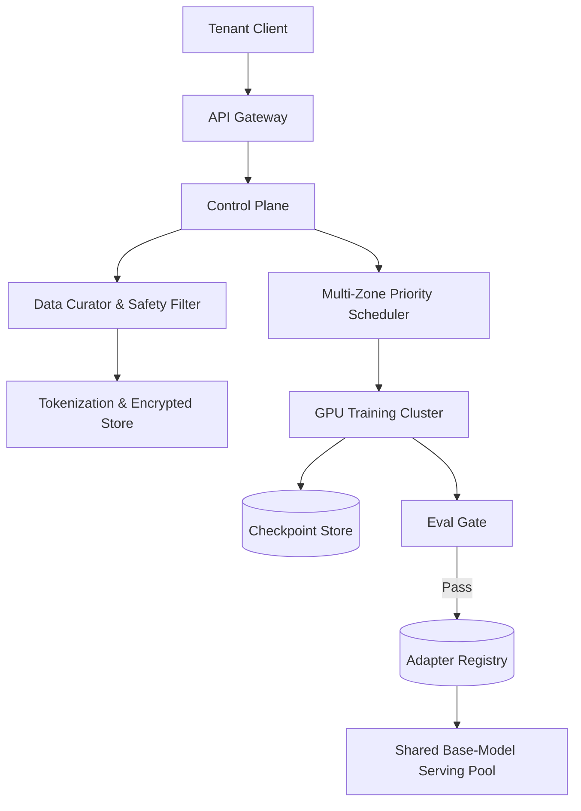

# Coach Answer: LoRA Fine-Tuning Pipeline

> Type: GenAI High-Level Design  
> Difficulty: Advanced  
> Time Target: 45 minutes

---

## Phase 1 — Framing & Scope (5 min)

Frame the system as a multi-tenant Fine-Tune-as-a-Service platform built on Parameter-Efficient Fine-Tuning (PEFT) via Low-Rank Adaptation (LoRA). Instead of training and storing full multi-gigabyte model checkpoints per tenant, the platform freezes base weights and trains compact low-rank adapters (10–50 MB each). This enables rapid iteration, low storage overhead, and dynamic adapter hot-swapping onto shared inference pools.

Scope V1 around supervised LoRA fine-tuning: data curation and safety filtering, multi-zone GPU scheduling, preemption-safe checkpointing, automated evaluation gating, an immutable adapter registry, online hot-swapping with instant rollback, tenant isolation, and GPU-hour accounting. Defer full-parameter pretraining and RLHF clusters.

---

## Phase 2 — Requirements, Scale & Resource Budgets (5 min)

- **Functional:** Validate dataset schemas and strip PII/toxic rows before GPU allocation; encrypt tenant datasets at rest and in transit with isolated keys; validate LoRA rank and alpha scaling configs; schedule jobs across priority queues and zones; checkpoint every *N* steps; gate promotion via automated evaluation; register versioned adapters; hot-swap adapters at inference time; meter exact GPU-hours per tenant.
- **Non-Functional:** Strict cross-tenant isolation across storage, keys, containers, and VRAM; high GPU utilization via preemptible pools; deterministic job state machine (`Queued -> Training -> Evaluating -> Registered`) with full artifact lineage.

---

## Phase 3 — High-Level Architecture & Data Flow (10 min)

Separate the **Control Plane** (API gateway, curation orchestrator, job metadata, scheduler, registry, GPU-hour metering) from the **Data Plane** (isolated GPU training, evaluation, and shared serving workers).

1. **Curate & Tokenize:** Validate schemas, filter PII/toxicity, encrypt with tenant-specific keys, and tokenize into training shards.
2. **Schedule & Train:** Validate LoRA rank/alpha parameters, enqueue by priority, and dispatch onto multi-zone GPU nodes.
3. **Checkpoint & Evaluate:** Flush periodic checkpoints; upon completion, transition `Training -> Evaluating` to run automated quality and safety gates.
4. **Register & Hot-Swap:** Store passing adapters as immutable versions. Serving workers load compact adapters on demand alongside a shared frozen base model, routing via tenant/adapter headers.

---

## Phase 4 — Deep Dives (10 min)

### Multi-Zone Scheduling & Checkpointing
To control compute spend, the scheduler bin-packs jobs across zones onto preemptible GPUs while honoring priority queues and per-tenant quotas. Checkpointing every *N* steps bounds lost work when preemptible nodes terminate. **Asynchronous checkpointing** copies adapter weights and optimizer state to host RAM and flushes to durable object storage in a background thread so GPUs never stall mid-epoch.

### Evaluation Gates, Registry & Rollback
Adapters never promote directly from training. The evaluation gate runs task accuracy, formatting, and safety benchmarks against a baseline. Passing artifacts receive immutable version IDs linked to dataset digest, base-model digest, and hyperparameters. Serving routers resolve logical tenant aliases to immutable versions, making production rollback an atomic metadata pointer flip with zero re-deployment.

### Multi-Tenant Adapter Hot-Swapping & Isolation
Because LoRA adapters are 10–50 MB while base models occupy tens of gigabytes of VRAM, one serving node keeps a single frozen base model resident and caches dozens of tenant adapters in VRAM. Custom routing headers select the tenant's adapter for batched forward passes, evicting cold adapters via LRU. Training jobs run in ephemeral, network-isolated containers with per-tenant encryption keys, VRAM scrubbing between runs, and wall-clock GPU-hour metering (excluding platform-induced retries) for accurate chargeback.

---

## Phase 5 — Failure Paths, Safety & Resilience (5 min)

- **Preemptible Node Loss:** Missed heartbeats requeue the job onto a healthy node, which resumes from the last committed checkpoint.
- **Tainted Datasets:** Curation rejects PII-laden, toxic, or malformed inputs before allocating any GPU.
- **Post-Launch Regression:** Failed eval jobs are quarantined; production regressions revert immediately by flipping the registry alias to the prior version.
- **Noisy Neighbors:** Priority queues, per-tenant concurrency caps, and bounded adapter VRAM quotas protect shared SLAs.

---

## Phase 6 — Key Trade-Offs (5 min)

| Decision | Option A | Option B | Chosen & Rationale |
|---|---|---|---|
| Checkpointing | Synchronous (blocks GPU) | Asynchronous (host-RAM staging) | Async preserves GPU utilization during long runs |
| Checkpoint store | Shared distributed filesystem | Object storage + local NVMe staging | Object storage scales durably at lower overhead |
| Serving layout | Dedicated replica per tenant | Shared base model + LoRA hot-swap | Cuts VRAM footprint dramatically across tenants |
| Compute tiering | On-demand GPUs only | Preemptible + checkpoints; on-demand for urgent | Lowers compute spend while bounding preemption loss |

---

## Phase 7 — Wrap-Up & Follow-Up Questions (5 min)

Decoupling control and data planes, gating raw data before GPU allocation, checkpointing asynchronously, enforcing automated eval gates in an immutable registry, and hot-swapping adapters onto shared base models deliver scalable, isolated Fine-Tune-as-a-Service.

**Follow-Ups:**
- *How do you upgrade the base model?* Maintain dual base-model pools and automatically re-tune and re-evaluate active tenant adapters against the new base digest.
- *How do you batch mixed-adapter traffic?* Execute batched low-rank projections alongside the shared base forward pass with an LRU cap on resident adapters.

---

## Strong vs. Weak Answer Signals

- **Strong Answer:** Separates control and data planes, enforces PII/toxicity curation and per-tenant encryption pre-GPU, uses async preemption-safe checkpoints, gates releases with an immutable registry and instant rollback, explains VRAM-shared adapter hot-swapping, and meters GPU-hours cleanly.
- **Weak Answer:** Treats fine-tuning as an ad-hoc script, proposes dedicated full-model replicas per tenant, ignores preemptible recovery, or omits data curation, eval gates, and rollback.
