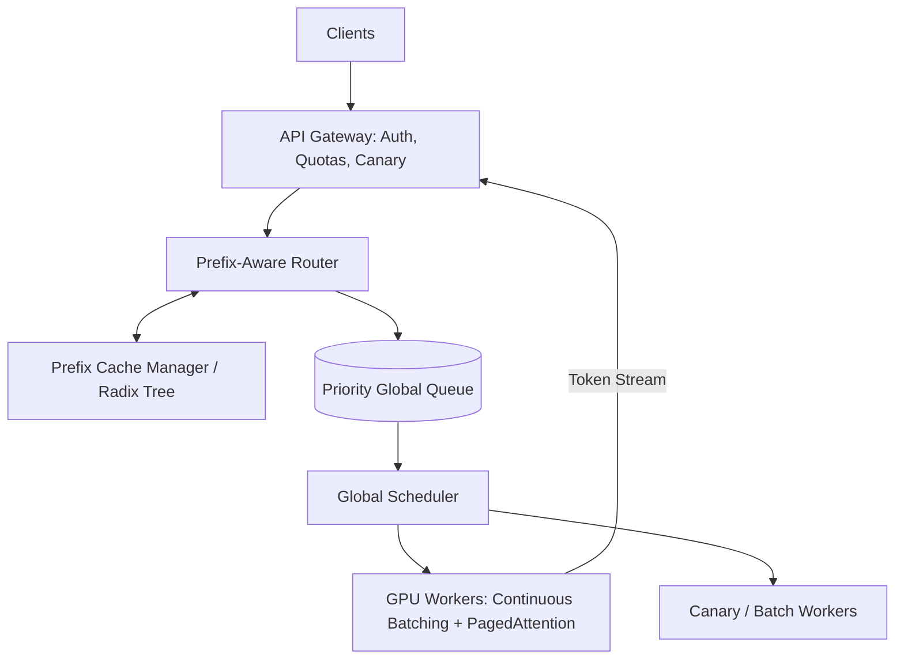

# Coach Answer: LLM Inference Serving Platform

> Type: GenAI High-Level Design  
> Difficulty: Advanced  
> Time Target: 45 minutes

---

## Phase 1 — Framing & Scope (5 min)

Frame the platform as a multi-tenant compute fleet managed by a cloud-native control plane. Unlike stateless web services, LLM serving has two distinct hardware regimes: **prefill** (prompt processing) is compute-bound, while **decode** (autoregressive token generation) is memory-bandwidth-bound and capped by Key-Value (KV) cache VRAM.

Scope V1 to serve four workloads on shared GPU pools: interactive chatbots (sub-second TTFT, multi-turn shared prefixes), in-IDE coding assistants (fill-in-the-middle, <300 ms turnaround, bursty traffic), offline batch jobs (throughput-first, lower priority), and agentic workflows (growing prompt histories). Core capabilities: prefix-aware routing, continuous batching, PagedAttention, fast autoscaling with cold-start mitigation, tenant quotas, fault recovery, and canary rollouts.

---

## Phase 2 — Requirements, Scale & Capacity Math (5 min)

- **Targets:** 99.99% availability, P99 TTFT < 500 ms for interactive traffic, P99 inter-token latency (ITL) < 50 ms (~20–30 tokens/sec), 10,000 peak concurrent users, and ~1,000 RPS across hundreds of GPUs.
- **Memory Math:** A 70B-parameter model in FP8 (1 byte/param) needs ~70 GB for weights. Across two 80 GB accelerators (`TP=2`, 160 GB total), ~60+ GB remains for KV cache. In FP16 (80 layers, 64 heads, 128 dim/head), each token takes `2 × 80 × 64 × 128 × 2 ≈ 2.6 MB` of KV cache. Long sequences consume tens of gigabytes, making KV VRAM the primary ceiling on batch size.

---

## Phase 3 — High-Level Architecture & Data Flow (10 min)

1. **Ingress & Quotas:** Authenticate tenants, enforce per-tenant Token Bucket quotas (RPS and tokens/min) in a distributed key-value store, and apply weighted canary routing with session affinity.
2. **Prefix-Aware Routing:** Hash prompt boundaries and consult a distributed Radix Tree to route shared prefixes to the worker holding those cached KV blocks.
3. **Priority Scheduling:** Queue requests by SLA tier (interactive ahead of batch) and dispatch based on worker load and free KV blocks.
4. **Execution & Safety:** Run iteration-level continuous batching with PagedAttention and stream tokens while an async prompt-injection filter runs alongside prefill to halt malicious requests early.

---

## Phase 4 — Deep Dives (10 min)

### Continuous Batching & PagedAttention
Static batching idles GPUs while short sequences wait for the longest sequence. **Continuous (iteration-level) batching** evicts finished sequences immediately on end-of-sequence and injects new requests on the next decode step, boosting arithmetic intensity. **PagedAttention** maps logical KV cache to fixed-size physical blocks (e.g., 16 tokens/block), eliminating fragmentation, expanding effective batch size 2–4×, and enabling copy-on-write prefix sharing.

### Prefix Routing, Parallelism & Optimizations
Round-robin routing destroys KV locality. Radix Tree routing directs a 1,200-token prompt with 1,000 cached prefix tokens straight to the warm worker, running prefill on only 200 tokens. Use **Tensor Parallelism (TP)** within a node over high-bandwidth intra-node links to minimize latency, and **Pipeline Parallelism (PP)** across nodes only when weights exceed single-node VRAM. Advanced optimizations include **disaggregated prefill/decode pools** (transferring KV tensors over high-speed fabric), **speculative decoding** (a compact draft model proposes *N* tokens verified in one pass), and **dynamic LoRA adapters** on shared base weights.

### Autoscaling & Cold Starts
Scale-out triggers on queue depth and TTFT. To cut multi-minute 70B cold starts, combine pre-warmed empty node pools, peer-to-peer image distribution, local NVMe weight caching, and memory-mapped (`mmap`) zero-copy loading (such as Safetensors) into VRAM via PCIe DMA.

---

## Phase 5 — Failure Paths, Safety & Resilience (5 min)

- **10× Spike (Faster Than 5-Min Boot):** Gateway returns HTTP 429 on quota breaches, the global queue caps depth, the scheduler prioritizes interactive SLAs over batch, and workers widen batch sizes until new nodes join.
- **Worker Crash / OOM:** Strict PagedAttention admission prevents OOMs. On hardware crashes, missed heartbeats mark the worker dead; the gateway intercepts the broken stream and retries on a healthy worker, recomputing prefill.
- **Canary Rollout:** Shift traffic 1% → 10% → 50% → 100% on an isolated pool with sticky session affinity; roll back immediately on latency or error spikes.

---

## Phase 6 — Key Trade-Offs (5 min)

| Decision | Option A | Option B | Chosen & Rationale |
|---|---|---|---|
| Batching | Static sequence batching | Iteration-level continuous batching | Removes idle padding and boosts throughput |
| KV memory | Contiguous pre-allocation | PagedAttention fixed blocks | Eliminates fragmentation; enables prefix sharing |
| Parallelism | Pipeline Parallelism everywhere | Intra-node TP + cross-node PP | Minimizes latency; avoids pipeline bubbles |
| Routing | Stateless round-robin | Prefix-aware Radix Tree | Preserves KV hits and cuts prefill TTFT |

---

## Phase 7 — Wrap-Up & Follow-Up Questions (5 min)

Efficient LLM serving bridges GPU memory physics and distributed systems: continuous batching and PagedAttention maximize occupancy, prefix routing cuts redundant prefill, and pre-warmed pools, priority queues, and canary gates protect tail SLAs.

**Follow-Ups:**
- *How do you keep runtimes swappable?* Abstract inference engines behind a standard gRPC API.
- *What telemetry matters?* Combine GPU metrics (SM utilization, VRAM, interconnect bandwidth) with TTFT, ITL, tokens/sec, queue wait time, and distributed traces.

---

## Strong vs. Weak Answer Signals

- **Strong Answer:** Contrasts compute-bound prefill with memory-bound decode, quantifies KV VRAM limits, designs continuous batching with PagedAttention and Radix Tree routing, mitigates cold starts, isolates interactive vs. batch queues, and details worker recovery and sticky canaries.
- **Weak Answer:** Treats LLM serving as stateless round-robin microservices, ignores KV cache math, assumes instant GPU autoscaling, or omits priority queues and retry recovery.
