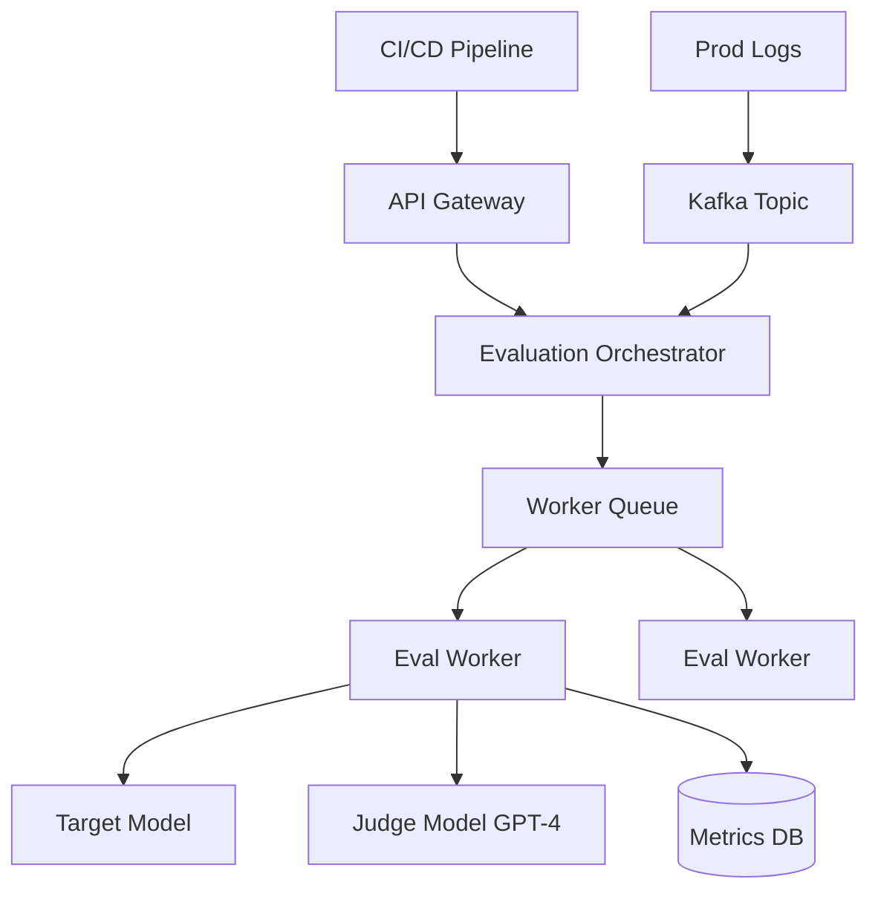
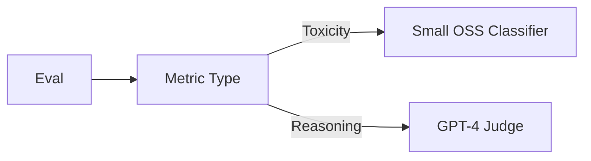

# Coach Answer: LLM Evaluation & Benchmark Platform

> Type: GenAI High-Level Design  
> Difficulty: Advanced  
> Time Target: 45 minutes

---

## 1. 🎯 Requirements & Core Metrics

### Functional Requirements
- **Core Functionality:** Automated platform for running offline evaluations (LLM-as-a-judge) to detect drift and benchmark models.
- **Target Audience:** AI Engineers and ML Researchers.
- **Key GenAI Features:** 
  - Asynchronous evaluation pipelines.
  - Multi-judge consensus (e.g., Self-Consistency).
  - Synthetic data generation (Evol-Instruct).

### Non-Functional Requirements (NFRs)
- **High Availability:** 99.9% uptime for API triggers.
- **Throughput:** High batch processing capabilities (e.g., 10,000 evals/hour).
- **Reliability:** Idempotent evaluation execution.

---

## 2. 🧮 Back-of-the-Envelope Estimation

### Traffic & Scale
- **Daily Evaluations:** 500,000 tasks.
- **Average QPS:** ~10 QPS (bursty during CI/CD).

### Storage & Bandwidth
- **Tokens per Call:** 3000 input, 100 output (judge score).
- **Cost:** High judge cost. Cache identical requests aggressively.

---

## 3. 🔌 API Design

**Endpoint:** `POST /v1/eval/trigger`

**Request:**
```json
{
  "dataset_id": "ds_123",
  "target_model": "llama-3-70b",
  "metrics": ["faithfulness", "relevance"]
}
```

---

## 4. 💾 Data Model & Schema

**PostgreSQL (Evaluation Results):**
```sql
CREATE TABLE eval_runs (
    id UUID PRIMARY KEY,
    model_name VARCHAR(100),
    score_avg FLOAT,
    created_at TIMESTAMP DEFAULT NOW()
);
```

---

## 5. 🏗️ High-Level Architecture

### Architecture Diagram



### Data Flow
1. **Trigger:** CI/CD or Prod logs trigger evaluation.
2. **Orchestration:** Orchestrator pulls Golden Dataset.
3. **Queueing:** Tasks distributed via RabbitMQ/Kafka.
4. **Execution:** Worker calls Target Model, then passes output to Judge Model.
5. **Storage:** Results aggregated in Metrics DB.

---

## 6. 🔍 Deep Dives — Classical

### 6.1 Scaling Strategy
- **Horizontal Scaling:** Worker nodes scale based on queue depth.
- **Rate Limiting:** Throttle requests to Judge APIs to prevent HTTP 429s.

### 6.2 Caching Approach
| Cache Layer | What to Cache | TTL | Invalidation |
|-------------|---------------|-----|--------------|
| Judge Cache | Hash(Prompt + Target Output) -> Score | 30d | Manual |

---

## 7. 🔍 Deep Dives — GenAI-Specific

### 7.1 🎯 Token & Context Budget Planning

**Context Window Allocation (Judge):**
```
┌─────────────────────────────────────────────┐
│           Context Window (8192 tokens)       │
├─────────────┬──────────┬─────────┬──────────┤
│Rubric Prompt│ Reference│  Output │  Score   │
│ (1000 tk)   │ (4000 tk)│(3000 tk)│  (10 tk) │
└─────────────┴──────────┴─────────┴──────────┘
```

### 7.2 🔀 LLM Routing / Model Selection



### 7.3 🛡️ Safety / Moderation / Red-Teaming Hooks
- **Bias Mitigation:** Swapped-order evaluations (`Judge(A,B)` and `Judge(B,A)`) to prevent positional bias.

### 7.4 📈 Evaluation and Feedback Loops
- **ELO Tournament:** Continuous background head-to-head benchmarking of models.

---

## 8. ⚖️ Trade-offs

### Decision 1: Human vs LLM-as-a-Judge
| Human | LLM-as-a-Judge |
|-------|----------------|
| Pros: Ground truth, reliable | Pros: Fast, scalable, cheap |
| Cons: Slow, expensive | Cons: Bias, requires validation |
**Chose:** LLM-as-a-Judge with a 5% human audit sample to maintain alignment.

---

## 9. 🔮 Follow-up Questions

### Scaling Questions
- **How to prevent overfitting?** Use Evol-Instruct pipelines to continuously mutate and expand the golden dataset.


