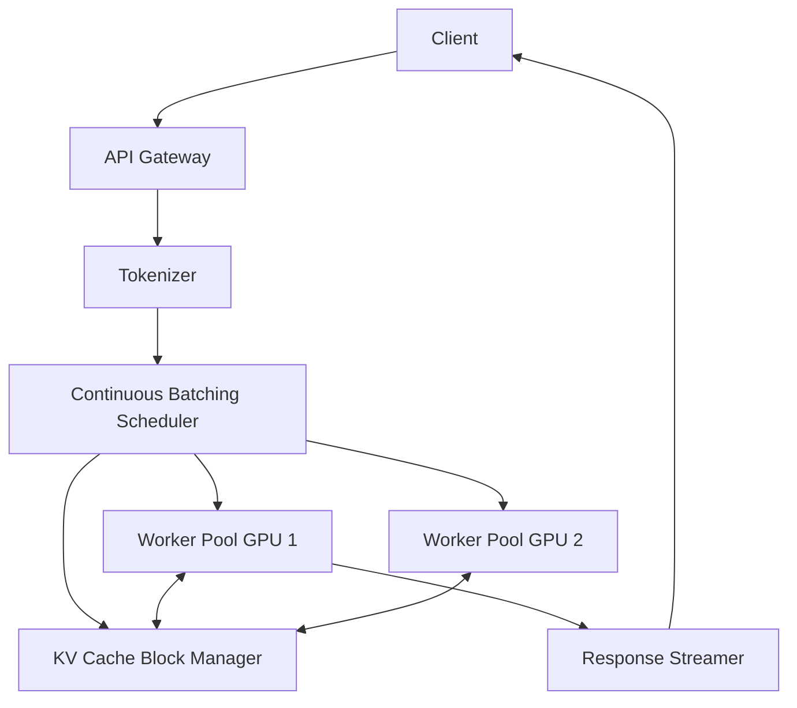
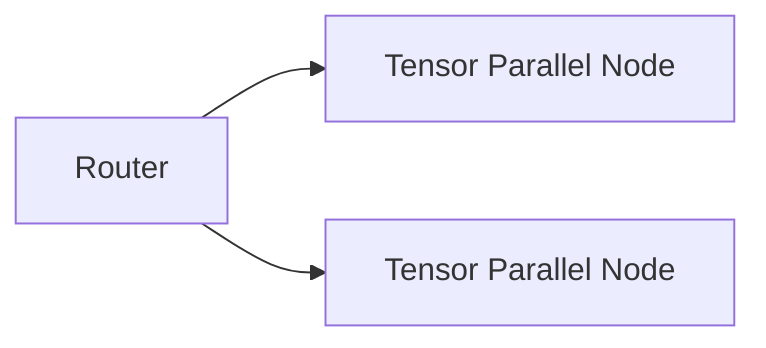

# Coach Answer: LLM Inference Serving Engine

> Type: GenAI High-Level Design  
> Difficulty: Advanced  
> Time Target: 45 minutes

---

## 1. 🎯 Requirements & Core Metrics

### Functional Requirements
- **Core Functionality:** High-throughput, low-latency engine for serving LLMs.
- **Target Audience:** API consumers and internal applications.
- **Key GenAI Features:** 
  - Token streaming.
  - Efficient KV cache management.
  - Continuous batching for variable length outputs.

### Non-Functional Requirements (NFRs)
- **High Availability:** 99.99% uptime.
- **Low Latency:** ITL (Inter-Token Latency) < 50ms, TTFT < 200ms.
- **Scalability:** Maximize GPU utilization.

---

## 2. 🧮 Back-of-the-Envelope Estimation

### Traffic & Scale
- **Peak QPS:** ~10,000 QPS.
- **Bottleneck:** Memory Bandwidth (not compute) during the decode phase.

### Storage & Bandwidth
- **VRAM Constraint:** KV Cache size dictates maximum batch size.

---

## 3. 🔌 API Design

**Endpoint:** `POST /v1/completions`

**Request:**
```json
{
  "prompt": "Explain quantum computing.",
  "stream": true
}
```

---

## 4. 💾 Data Model & Schema

**In-Memory (KV Cache Block Table):**
- **PagedAttention Mapping:** Logical tokens mapped to physical 16-token memory blocks.

---

## 5. 🏗️ High-Level Architecture

### Architecture Diagram



### Data Flow
1. **Request:** Prompt tokenized.
2. **Scheduling:** Request added to waiting queue.
3. **Execution (Prefill):** Compute-heavy first pass.
4. **Execution (Decode):** Memory-bound token generation via Continuous Batching.
5. **Streaming:** Tokens streamed to client.

---

## 6. 🔍 Deep Dives — Classical

### 6.1 Scaling Strategy
- **Tensor Parallelism:** Split large models across multiple GPUs within a node.
- **Pipeline Parallelism:** Split layers across multiple nodes.

### 6.2 Caching Approach
| Cache Layer | What to Cache | TTL | Invalidation |
|-------------|---------------|-----|--------------|
| Prefix Caching | Shared system prompts in KV Cache | N/A | LRU eviction |

---

## 7. 🔍 Deep Dives — GenAI-Specific

### 7.1 🎯 Token & Context Budget Planning

**VRAM Allocation (80GB A100):**
```
┌─────────────────────────────────────────────┐
│           VRAM Allocation (80GB)             │
├─────────────┬──────────┬─────────┬──────────┤
│ Model Wgts  │ KV Cache │ Activtn │ Overhead │
│  (35GB)     │  (40GB)  │  (3GB)  │   (2GB)  │
└─────────────┴──────────┴─────────┴──────────┘
```

### 7.2 🔀 LLM Routing / Model Selection



### 7.3 🛡️ Safety / Moderation / Red-Teaming Hooks
- Out of scope for inference engine core (handled at gateway).

### 7.4 📈 Evaluation and Feedback Loops
- **Metrics:** Track P99 TTFT, ITL, and GPU memory utilization (nvml).

---

## 8. ⚖️ Trade-offs

### Decision 1: Continuous Batching vs Static Batching
| Continuous Batching | Static Batching |
|---------------------|-----------------|
| Pros: High throughput, low queuing delay | Pros: Simple |
| Cons: Requires PagedAttention | Cons: GPU idle waiting for longest sequence |
**Chose:** Continuous Batching to eliminate internal fragmentation and boost throughput 10x.

---

## 9. 🔮 Follow-up Questions

### Scaling Questions
- **How to handle OOM?** Preempt sequences, swap their KV blocks to CPU RAM, and restore later instead of recomputing.


