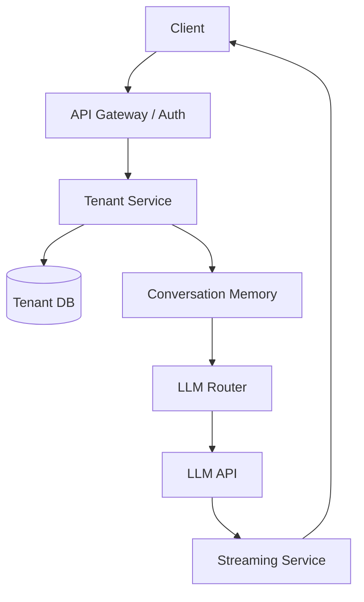
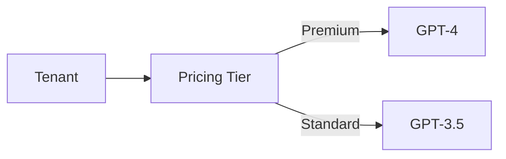

# Coach Answer: Multi-Tenant Chat Assistant

> Type: GenAI High-Level Design  
> Difficulty: Advanced  
> Time Target: 45 minutes

---

## 1. 🎯 Requirements & Core Metrics

### Functional Requirements
- **Core Functionality:** Scalable chat application supporting multiple organizations.
- **Target Audience:** B2B Enterprise clients.
- **Key GenAI Features:** 
  - Custom system prompts per tenant.
  - Multi-turn conversation state.
  - Streaming responses.

### Non-Functional Requirements (NFRs)
- **High Availability:** 99.99% uptime.
- **Security:** Strict data isolation between tenants.

---

## 2. 🧮 Back-of-the-Envelope Estimation

### Traffic & Scale
- **Tenants:** 5,000.
- **Daily Queries:** 20 Million.

### Storage & Bandwidth
- **Tokens per Call:** 1000 input, 300 output.
- **Cost:** ~$100,000/month.

---

## 3. 🔌 API Design

**Endpoint:** `POST /v1/chat/completions`

**Request:**
```json
{
  "tenant_id": "org_abc",
  "messages": [{"role": "user", "content": "Hello"}]
}
```

---

## 4. 💾 Data Model & Schema

**PostgreSQL (Tenant Config):**
```sql
CREATE TABLE tenants (
    id UUID PRIMARY KEY,
    system_prompt TEXT,
    rate_limit INT
);
```

---

## 5. 🏗️ High-Level Architecture

### Architecture Diagram



### Data Flow
1. **Auth:** Validate tenant API key.
2. **Context:** Load tenant custom prompt and conversation history.
3. **Generate:** Stream tokens back to client.

---

## 6. 🔍 Deep Dives — Classical

### 6.1 Scaling Strategy
- **Database Scaling:** Shard conversation history by `tenant_id`.

### 6.2 Caching Approach
| Cache Layer | What to Cache | TTL | Invalidation |
|-------------|---------------|-----|--------------|
| Prompt Cache | Tenant system prompts | 24h | Update |

---

## 7. 🔍 Deep Dives — GenAI-Specific

### 7.1 🎯 Token & Context Budget Planning

**Context Window Allocation:**
```
┌─────────────────────────────────────────────┐
│           Context Window (8192 tokens)       │
├─────────────┬──────────┬─────────┬──────────┤
│Tenant Prompt│ History  │  Query  │  Output  │
│ (1000 tk)   │ (4000 tk)│(1000 tk)│ (2192 tk)│
└─────────────┴──────────┴─────────┴──────────┘
```

### 7.2 🔀 LLM Routing / Model Selection



### 7.3 🛡️ Safety / Moderation / Red-Teaming Hooks
- **Data Isolation:** Never use Tenant A's data to train/fine-tune models shared with Tenant B.

### 7.4 📈 Evaluation and Feedback Loops
- **Metrics:** Track token usage per tenant for billing.

---

## 8. ⚖️ Trade-offs

### Decision 1: Shared LLM vs Dedicated Instances
| Shared | Dedicated |
|--------|-----------|
| Pros: Cheap, scalable | Pros: Predictable latency, high security |
| Cons: Noisy neighbor | Cons: Very expensive |
**Chose:** Shared LLM API with strict application-level rate limits per tenant.

---

## 9. 🔮 Follow-up Questions

### Scaling Questions
- **How to prevent noisy neighbors?** Token bucket rate limiting at the API gateway based on `tenant_id`.


