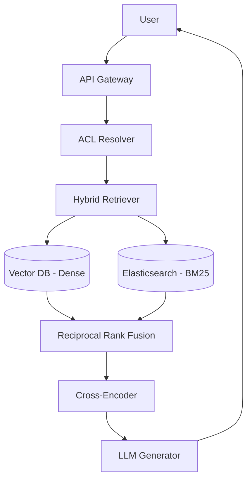
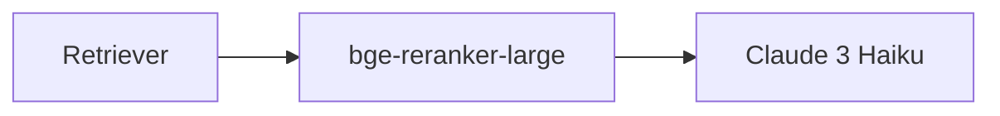

# Coach Answer: Multi-Tenant Enterprise RAG

> Type: GenAI High-Level Design  
> Difficulty: Advanced  
> Time Target: 45 minutes

---

## 1. 🎯 Requirements & Core Metrics

### Functional Requirements
- **Core Functionality:** RAG system for 1,000 enterprise tenants.
- **Target Audience:** Enterprise knowledge workers.
- **Key GenAI Features:** 
  - Strict RBAC/ABAC at retrieval time.
  - Hybrid Search (Dense + BM25).
  - Cross-Encoder Reranking.

### Non-Functional Requirements (NFRs)
- **Low Latency:** Sub-500ms retrieval p95 SLA.
- **Scale:** 100M documents.

---

## 2. 🧮 Back-of-the-Envelope Estimation

### Traffic & Scale
- **Vector DB Size:** 100M docs = ~500M chunks = 750GB of embeddings (FP16).

---

## 3. 🔌 API Design

**Endpoint:** `POST /v1/search/rag`

**Request:**
```json
{
  "tenant_id": "org_789",
  "user_id": "usr_123",
  "query": "Q3 Revenue"
}
```

---

## 4. 💾 Data Model & Schema

**Vector DB:**
- **Chunks:** `{ chunk_id, embedding, text, metadata(tenant_id, allowed_groups) }`

---

## 5. 🏗️ High-Level Architecture

### Architecture Diagram



### Data Flow
1. **Query:** User searches. ACL Resolver fetches user's allowed groups.
2. **Retrieval:** Hybrid search executed with Pre-Filtering ACL tags.
3. **Fusion:** RRF merges vector and keyword results.
4. **Reranking:** Cross-encoder scores top 20 results.
5. **Generation:** LLM generates answer.

---

## 6. 🔍 Deep Dives — Classical

### 6.1 Scaling Strategy
- **Vector DB Partitioning:** Partition by `tenant_id` to speed up search.

---

## 7. 🔍 Deep Dives — GenAI-Specific

### 7.1 🎯 Token & Context Budget Planning

**Context Window Allocation:**
```
┌─────────────────────────────────────────────┐
│           Context Window (8192 tokens)       │
├─────────────┬──────────┬─────────┬──────────┤
│System Prompt│ Top-5 Doc│  Query  │  Output  │
│ (200 tk)    │ (2000 tk)│(100 tk) │ (1000 tk)│
└─────────────┴──────────┴─────────┴──────────┘
```

### 7.2 🔀 LLM Routing / Model Selection



### 7.3 🛡️ Safety / Moderation / Red-Teaming Hooks
- **ACL Filtering:** Must use Pre-Filtering at the DB level, NOT Post-Filtering in application code.

### 7.4 📈 Evaluation and Feedback Loops
- **Metrics:** nDCG@5 for retrieval accuracy.

---

## 8. ⚖️ Trade-offs

### Decision 1: Pre-filtering vs Post-filtering ACLs
| Pre-filtering | Post-filtering |
|---------------|----------------|
| Pros: Avoids recall cliff | Pros: Fast vector search |
| Cons: Slow traversal | Cons: Can return 0 results if heavily restricted |
**Chose:** Pre-filtering. Post-filtering is disastrous for recall in a highly restricted enterprise environment.

---

## 9. 🔮 Follow-up Questions

### Scaling Questions
- **How to meet sub-500ms SLA?** Limit cross-encoder reranking to only the top 20 documents; do not pass hundreds of docs to the heavy cross-encoder.


