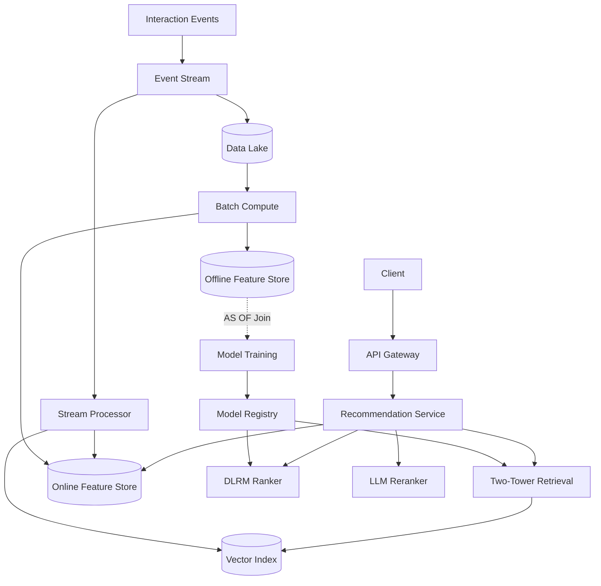

# Coach Answer: Recommendation Feature Store

> Type: GenAI High-Level Design  
> Difficulty: Advanced  
> Time Target: 45 minutes

---

## Phase 1 — Framing & Scope (5 min)

Say: "Recommendations at scale are a multi-stage funnel backed by a dual-store feature platform. I will separate offline training from online serving while sharing feature definitions, prevent leakage with point-in-time joins, and reserve generative reranking for the top 10 candidates."

- **System Goal:** Serve personalized item recommendations from a large catalog using two-tower retrieval, real-time and batch features, deep neural ranking, and optional LLM reranking with explanations.
- **GenAI vs. Classical ML:** Two-tower retrieval and a deep learning recommendation model (DLRM) narrow tens of millions of items at low latency. Generative models produce zero-shot semantic embeddings for cold-start items and rerank/explain the final top 10.
- **Out of Scope (V1):** Ad-auction bidding, per-click online gradient updates, and raw video-frame encoding.

---

## Phase 2 — Requirements & Capacity Estimation (5 min)

### Functional Requirements
- Ingest user interactions (views, clicks, purchases) and item metadata into offline and online feature stores.
- Retrieve ~1,000 candidates via two-tower embeddings and score them with a deep ranker.
- Optionally rerank the top 10 candidates with a compact generative reranker for ordering and explanations.
- Support cold-start users/items and A/B experimentation across retrieval and ranking variants.

### Non-Functional Requirements & Scale
- **Scale:** 100M+ items and 10M+ active users.
- **Latency Budget:** < 200ms p95 total (Retrieval ~30ms, Online Feature Lookup ~20ms, DLRM Ranking ~60ms, Optional LLM Rerank ~70ms, Network ~20ms).
- **Freshness & Correctness:** Sub-second streaming session features, hourly/daily batch aggregates, and zero future-data leakage in training sets.

---

## Phase 3 — High-Level Architecture (10 min)

### Data Flow
1. **Feature Ingestion:** Events enter a distributed stream. Stream processors compute rolling session features (last five items viewed, session duration) into the low-latency online store. Batch jobs over the data lake compute demographics and 30-day click-through rates, syncing to both offline and online stores.
2. **Online Serving:** The Recommendation Service retrieves ~1,000 candidates from the vector index, fetches user/item features from the online store, scores them with the DLRM ranker down to ~50 items, applies business filters, and optionally sends the top 10 to the LLM reranker.

---

## Phase 4 — Core Deep Dives (10 min)

### 1. Training-Serving Skew & Point-in-Time Joins
- **Unified Definitions:** Declare feature transforms once and materialize them to both stores so streaming updates match offline batch logic.
- **Point-in-Time (`AS OF`) Joins:** When joining historical click labels at time `T` with feature logs, fetch only values valid at `T_feature <= T`. Standard SQL joins leak future statistics, inflating offline AUC while failing online.

### 2. Multi-Stage Funnel & Cold Start
- **Two-Tower Retrieval:** Independent user and item towers let us pre-compute 100M+ item vectors offline for sub-50ms ANN search; cross-encoders cannot scan the full catalog at runtime.
- **Cold Start:** New items lack clicks for collaborative filtering. On upload, a semantic embedding model encodes title, description, and tags into a dense vector inserted into the vector index for immediate retrieval. For new users, multi-armed bandits balance exploration and exploitation.

---

## Phase 5 — Failure Paths, Safety & Guardrails (5 min)

- **LLM Reranker Timeout:** Enforce a strict per-call deadline; on timeout or overload, fall back to the DLRM ranked order without explanations.
- **Online Store Degradation:** Cache slow-moving features locally in serving pods and impute defaults instead of failing requests.
- **Filter Bubbles & Position Bias:** Inject randomized exploration slots via bandits and log impression positions to debias training.
- **Observability:** Track online feature null rates, offline-to-online distribution drift, p99 stage latency, and A/B metrics (CTR, conversion, retention).

---

## Phase 6 — Key Trade-Offs (5 min)

| Decision | Option A | Option B | Chosen & Rationale |
|---|---|---|---|
| Feature Storage | Single analytical warehouse | Dual Offline + Online store | Dual store: warehouses cannot serve sub-ms high-QPS lookups. |
| Retrieval | Cross-encoder over catalog | Two-tower + ANN index | Two-tower: pre-computed vectors make 100M-item search feasible. |
| Heavy Ranker | Gradient boosted trees | Deep learning ranker (DLRM) | DLRM: scales across sparse user/item ID embedding tables. |
| LLM Scope | Rerank top 100+ items | Rerank top 10 items | Top 10: preserves the 200ms end-to-end latency budget. |

---

## Phase 7 — Wrap-Up & Follow-Up Extensions (5 min)

- **1B-Item Catalog:** Apply Product Quantization (PQ) to compress vectors in RAM and shard the vector index with scatter-gather top-K merging.
- **Popularity Skew:** Counter viral head-item dominance with negative sampling, log-scaled counts during training, and impression caps at serving time.
- **Continuous Retraining:** Automate feature-drift alerts, shadow evaluation, and canary rollouts via the model registry.

---

## Strong vs. Weak Answer

| Dimension | Strong Answer | Weak Answer |
|---|---|---|
| Architecture | Multi-stage funnel with explicit per-stage latency budgets. | Runs a heavy model or LLM across the full catalog. |
| Feature Store | Dual offline/online stores, freshness tiers, and `AS OF` joins. | Single database or standard SQL joins causing leakage and skew. |
| Cold Start | Zero-shot semantic item embeddings plus bandit exploration. | Ignores cold-start items, filter bubbles, and position bias. |
| Resilience | Bounds LLM reranking to top 10 with timeout fallback to DLRM. | Treats the LLM reranker as a hard synchronous dependency. |
