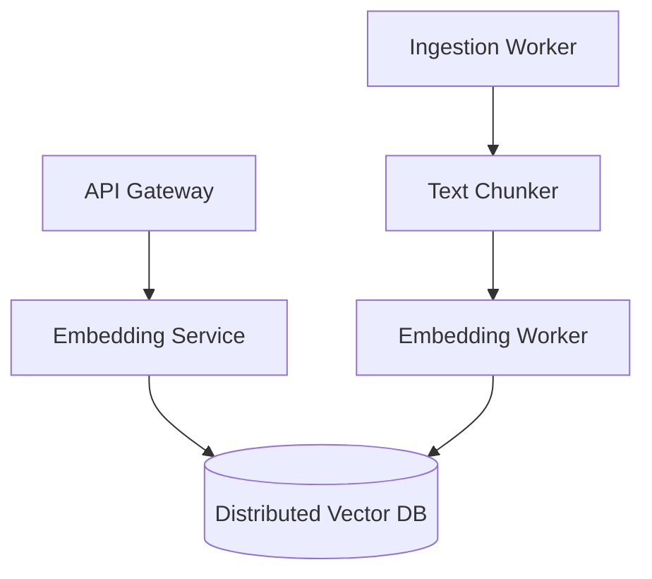

# Coach Answer: Semantic Retrieval Platform

> Type: GenAI High-Level Design  
> Difficulty: Advanced  
> Time Target: 45 minutes

---

## 1. 🎯 Requirements & Core Metrics

### Functional Requirements
- **Core Functionality:** Semantic search platform providing dense vector embeddings and metadata filtering.
- **Target Audience:** Developers integrating search into their apps.
- **Key GenAI Features:** 
  - Real-time document ingestion and chunking.
  - Asynchronous embedding generation.
  - Low-latency vector search.

### Non-Functional Requirements (NFRs)
- **High Availability:** 99.99% uptime.
- **Low Latency:** Search latency < 100ms.
- **Scalability:** 1 Billion vectors.

---

## 2. 🧮 Back-of-the-Envelope Estimation

### Traffic & Scale
- **Storage:** 1B vectors * 1536 dims * 4 bytes = ~6TB of RAM just for vectors (requires sharding).

---

## 3. 🔌 API Design

**Endpoint:** `POST /v1/search`

**Request:**
```json
{
  "query": "Machine learning",
  "top_k": 10,
  "filters": {"category": "tech"}
}
```

---

## 4. 💾 Data Model & Schema

**Vector DB (Milvus / Qdrant):**
- **Chunks:** `{ id, embedding, text, metadata }`
- **Index:** HNSW or IVF_PQ (Inverted File with Product Quantization) to save RAM.

---

## 5. 🏗️ High-Level Architecture

### Architecture Diagram



### Data Flow
1. **Ingest:** Text chunked, embedded, and indexed asynchronously.
2. **Search:** Query embedded in real-time, nearest neighbors found in Vector DB.

---

## 6. 🔍 Deep Dives — Classical

### 6.1 Scaling Strategy
- **Vector DB Sharding:** Shard by hash of document ID or tenant ID.

### 6.2 Caching Approach
| Cache Layer | What to Cache | TTL | Invalidation |
|-------------|---------------|-----|--------------|
| Result Cache| Exact query strings | 1h | LRU |

---

## 7. 🔍 Deep Dives — GenAI-Specific

### 7.1 🎯 Token & Context Budget Planning

**Context Window Allocation:**
- N/A for pure retrieval (no LLM generation phase).

### 7.2 🔀 LLM Routing / Model Selection


### 7.3 🛡️ Safety / Moderation / Red-Teaming Hooks
- Scan for malware or PII during ingestion before embedding.

### 7.4 📈 Evaluation and Feedback Loops
- **Metrics:** Recall@10, Mean Reciprocal Rank (MRR).

---

## 8. ⚖️ Trade-offs

### Decision 1: HNSW vs IVF_PQ
| HNSW | IVF_PQ |
|------|--------|
| Pros: High recall, fast | Pros: Low memory footprint |
| Cons: Huge RAM usage | Cons: Lower recall, slower |
**Chose:** IVF_PQ to fit 1 Billion vectors in a reasonable hardware budget, trading a few points of recall for massive cost savings.

---

## 9. 🔮 Follow-up Questions

### Scaling Questions
- **How to handle a sudden burst of ingestion?** Queue documents in Kafka and scale up embedding worker nodes dynamically.


