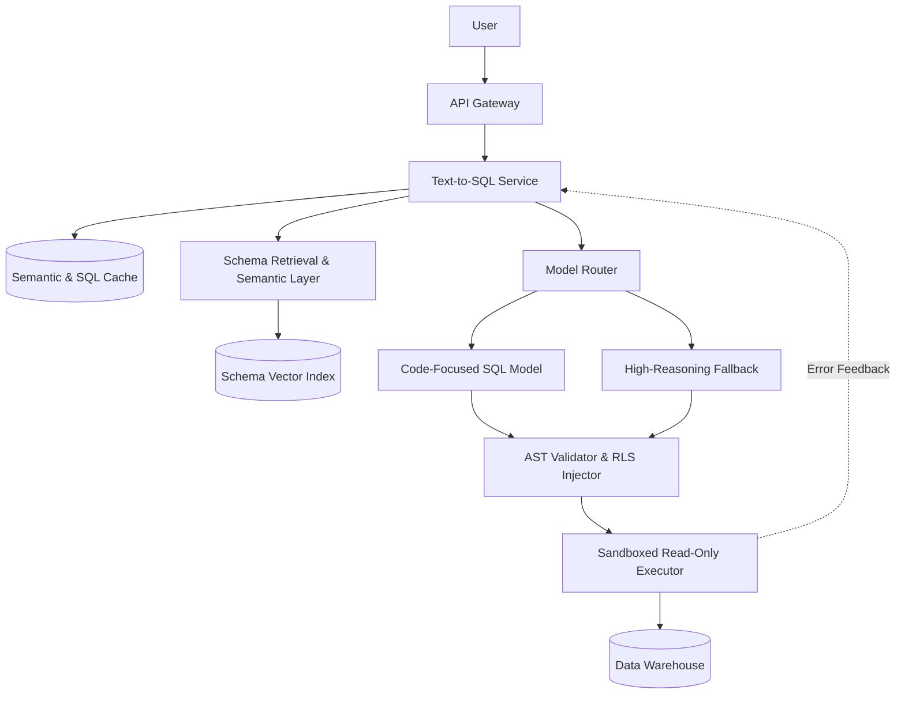

# Coach Answer: Text-to-SQL Analytics Assistant

> Type: GenAI High-Level Design  
> Difficulty: Advanced  
> Time Target: 45 minutes

---

## Phase 1 — Framing & Scope (5 min)

Say: "I will design this as a security-first, schema-grounded query translation pipeline. The LLM translates natural-language analytics questions into read-only SQL, while deterministic AST validation, row-level security, and sandboxed execution guarantee safe warehouse reads."

- **System Goal:** Let analysts and business users ask natural-language questions (such as regional monthly revenue) and receive executed results from a data warehouse.
- **GenAI vs. Deterministic Systems:** Semantic retrieval narrows the schema; a code-capable LLM generates and repairs SQL; deterministic AST parsers, read-only database roles, and sandbox executors enforce safety and tenant isolation.
- **Out of Scope (V1):** Mutating queries (`INSERT`, `UPDATE`, `DELETE`), schema migrations, and cross-warehouse federated joins.

---

## Phase 2 — Requirements & Capacity Estimation (5 min)

### Functional Requirements
- Retrieve relevant table schemas and semantic-layer business definitions per query.
- Generate dialect-accurate SQL with a brief explanation.
- Enforce AST validation, read-only execution, injection defense, and dynamic row-level security (RLS).
- Self-correct SQL syntax or execution errors in a bounded retry loop.
- Cache repeated natural-language questions or normalized SQL results and log execution accuracy.

### Non-Functional Requirements & Scale
- **Traffic:** 10,000 users × 50 queries/day = 500,000 queries/day (~10 QPS average, ~50 QPS peak).
- **Token Budget:** ~2,000 input tokens (retrieved schema + prompt) and ~500 output tokens (SQL + explanation).
- **Caching Impact:** Cache hits cut LLM token volume by ~40% on recurring analytics queries.
- **Reliability & Security:** High availability, low translation latency, and zero destructive operations.

---

## Phase 3 — High-Level Architecture (10 min)

### Data Flow
1. **Cache Lookup:** Check a tenant-scoped cache for identical or semantically equivalent questions.
2. **Schema Retrieval:** Embed the question and retrieve the top-K relevant tables, join keys, and semantic-layer metric definitions.
3. **Model Routing:** Route standard queries to a fast code-focused SQL model and escalate complex multi-join or window-function queries to a stronger reasoning model.
4. **Validation & Execution:** Parse SQL into an AST, reject anything other than a single `SELECT`, inject tenant RLS predicates, and execute under a read-only role in a resource-capped sandbox.

---

## Phase 4 — Core Deep Dives (10 min)

### 1. Schema Retrieval & Semantic Layer
- **Avoiding Full-Schema Prompts:** Passing hundreds of tables blows up token budgets and increases hallucinated columns.
- **Semantic Grounding:** Index table descriptions, column types, join relationships, and canonical metric formulas (e.g., how "net revenue" is computed) in a vector index so the generator receives only high-signal context.

### 2. Bounded Self-Correction Loop
- When the warehouse rejects a query for syntax, unknown column, or type errors, feed the failing SQL, database error message, and retrieved schema back to the model for repair.
- Cap retries at 2–3 attempts to bound latency and token usage; if repair fails, ask the user a targeted clarifying question.

---

## Phase 5 — Failure Paths, Safety & Guardrails (5 min)

- **Destructive SQL Defense:** Combine AST allow-listing (single `SELECT` only, blocking `DROP`/`DELETE`/`UPDATE`/`INSERT` and stacked statements) with database-enforced read-only credentials.
- **Row-Level Security (RLS):** Enforce tenant isolation via database RLS policies or AST rewriting that injects parameterized `WHERE tenant_id = ?` filters from the verified auth session—never from prompt text.
- **Runaway Scans:** Apply strict query timeouts, row limits, and scan-byte caps inside the sandbox executor to stop accidental Cartesian joins.
- **Evaluation & Monitoring:** Measure offline execution accuracy (result-set equivalence on golden queries), online first-pass execution success rate, self-correction recovery rate, cache hit rate, and p95 latency.

---

## Phase 6 — Key Trade-Offs (5 min)

| Decision | Option A | Option B | Chosen & Rationale |
|---|---|---|---|
| Schema Context | Full DDL in every prompt | Vector-retrieved top-K + semantic layer | Retrieved subset: cuts token load and reduces column hallucinations. |
| SQL Safety | Prompt rules only | AST validator + read-only role + RLS | Deterministic layers: prompts alone cannot stop injection. |
| Model Routing | Single large reasoning model | Fast code model + fallback escalation | Routed pair: balances latency and compute across query complexity. |
| Evaluation | Exact SQL string match | Execution result-set accuracy | Execution accuracy: valid SQL variants return identical tables. |

---

## Phase 7 — Wrap-Up & Follow-Up Extensions (5 min)

- **Multi-Turn Refinement:** Persist prior verified SQL and schema context so users can iteratively drill down by region or date.
- **Few-Shot Feedback Loop:** Index analyst-approved query pairs to improve accuracy on recurring domain questions.
- **Explain-Plan Guard:** Run `EXPLAIN` prior to execution to reject queries exceeding per-tenant scan quotas.

---

## Strong vs. Weak Answer

| Dimension | Strong Answer | Weak Answer |
|---|---|---|
| Security | Read-only DB roles, AST allow-listing, parameterized RLS, and sandbox caps. | Regex filters or prompt instructions alone to prevent `DROP TABLE`. |
| Schema Grounding | RAG over schema metadata plus a semantic layer for business metrics. | Dumps the full DDL into the prompt or ignores join metadata. |
| Reliability | Bounded error-driven self-correction loop and execution-accuracy evals. | Returns unexecuted SQL or retries indefinitely on DB errors. |
| Performance | Tenant-scoped semantic/SQL caching and complexity-based model routing. | Runs the heaviest model uncached on every repeated dashboard query. |
