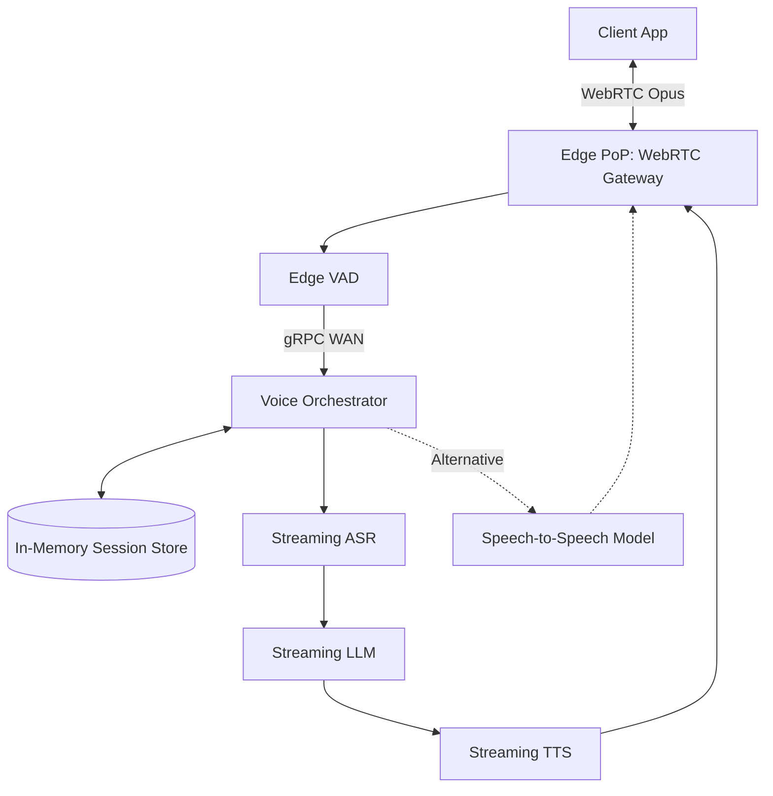

# Coach Answer: Real-Time Voice Assistant

> Type: GenAI High-Level Design  
> Difficulty: Advanced  
> Time Target: 45 minutes

---

## Phase 1 — Framing & Scope (5 min)

Say: "A real-time voice assistant is a streaming latency-budget and full-duplex turn-taking problem. I will terminate WebRTC audio and Voice Activity Detection at edge PoPs, overlap streaming ASR, LLM, and TTS in a core cluster to stay under 500ms time-to-first-audio, and cancel interrupted turns within 150ms."

- **System Goal:** Deliver natural, full-duplex spoken conversations over variable networks with sub-second response start and instant interruption handling.
- **GenAI vs. Infrastructure:** Edge media gateways, jitter buffers, and Voice Activity Detection (VAD) manage transport and turn boundaries; streaming ASR, LLM, and TTS—or an end-to-end speech-to-speech model—handle comprehension and speech synthesis.
- **Out of Scope (V1):** On-device wake-word training, multi-speaker diarization, and live video streaming.

---

## Phase 2 — Requirements & Capacity Estimation (5 min)

### Functional Requirements
- Bidirectional voice streaming between clients and the assistant.
- Accurate endpointing to detect turn completion without cutting users off.
- Barge-in support so users can interrupt mid-sentence.
- Stateful multi-turn memory that remains accurate after interruptions.

### Non-Functional Requirements & Scale
- **Availability:** 99.9% uptime across distributed edge PoPs.
- **Latency:** Time-to-First-Audio (TTFA) < 500ms (well under the ~800ms conversational ceiling); barge-in stop < 150ms.
- **Scale & Bandwidth:** 10,000 concurrent sessions × 32 kbps Opus audio = ~320 Mbps aggregate media bandwidth.

### Latency Budget
| Component | Target | Notes |
|---|---|---|
| Network RTT | 50ms | Nearest Edge PoP |
| VAD / Endpointing | 50ms | Beyond ~500ms silence threshold |
| Streaming ASR | 100ms | Incremental chunk transcription |
| Streaming LLM TTFT | 150ms | First text token |
| Streaming TTS | 150ms | First audio chunk |
| **Total TTFA** | **500ms** | Overlapped streaming pipeline |

---

## Phase 3 — High-Level Architecture (10 min)

### Data Flow
1. **Edge Termination:** Clients connect via WebRTC to the nearest Edge PoP, where Edge VAD detects speech onset and silence boundaries.
2. **Overlapped Inference:** Audio frames stream over gRPC to the core Voice Orchestrator. Partial ASR transcripts feed streaming LLM generation; phrase clauses flow into streaming TTS and return through the Edge Gateway.
3. **Session State:** A sub-millisecond in-memory store holds conversation history, turn IDs, and playback offsets so orchestrator workers autoscale cleanly.

---

## Phase 4 — Core Deep Dives (10 min)

### 1. Barge-In (Interruption) Handling
- When Edge VAD detects user speech during Turn `N` playback, it emits an interruption event to the Voice Orchestrator.
- Within 150ms, the orchestrator cancels in-flight LLM and TTS generation for Turn `N`, flushes gateway and client audio buffers, saves only the spoken prefix to session history (preventing unsaid text from corrupting context), and starts Turn `N+1`.

### 2. Streaming Chunking & Compute Efficiency
- **Chunk Sizing:** Smaller audio chunks (50ms) lower buffering latency but raise network framing overhead by ~15%. TTS synthesizes on short clause boundaries to balance TTFA and prosody.
- **Efficiency:** Edge caching for frequent utterances avoids 30–40% of repetitive LLM calls, and model quantization cuts GPU memory footprint by ~50%.

---

## Phase 5 — Failure Paths, Safety & Guardrails (5 min)

- **VAD & Noise:** Silence thresholds below 300ms cut users off; above 1,000ms feel sluggish. Combine acoustic echo cancellation and noise suppression with semantic turn detection to prevent false barge-ins.
- **Cascading ASR Errors:** Transcription errors (~5% word error rate in noise) propagate downstream. Pass confidence scores so low-confidence turns trigger brief clarification.
- **Jitter & Packet Loss:** Use WebRTC adaptive jitter buffers, forward error correction, and Opus packet-loss concealment rather than TCP retransmissions.
- **Safety & Observability:** Run lightweight streaming policy checks before TTS synthesis and track per-stage p95/p99 latency, barge-in stop time, WER, and GPU utilization.

---

## Phase 6 — Key Trade-Offs (5 min)

| Decision | Option A | Option B | Chosen & Rationale |
|---|---|---|---|
| Transport | HTTP/REST or WebSockets | WebRTC (UDP + Opus) | WebRTC: full-duplex media without TCP head-of-line blocking. |
| Pipeline | Speech-to-Speech | Cascaded ASR -> LLM -> TTS | Cascaded for V1 (auditable text, tools, guardrails); S2S for ~200ms lower latency and prosody. |
| VAD Placement | Core cluster | Edge PoP | Edge PoP: cuts RTT for endpointing and 150ms barge-in. |
| Chunk Size | Full-sentence buffers | 50ms streaming chunks | Small chunks: meets <500ms TTFA despite ~15% framing overhead. |

---

## Phase 7 — Wrap-Up & Follow-Up Extensions (5 min)

- **Hybrid S2S Routing:** Route expressive chat turns to speech-to-speech while keeping tool-calling or compliance-sensitive turns on the cascaded pipeline.
- **Adaptive Bitrate & Failover:** Step down Opus bitrate under congestion and migrate sessions across edge PoPs via shared in-memory state.
- **Async Tool Fillers:** Emit brief spoken acknowledgments while backend tool calls run asynchronously.

---

## Strong vs. Weak Answer

| Dimension | Strong Answer | Weak Answer |
|---|---|---|
| Transport & Edge | WebRTC at Edge PoPs with edge VAD and jitter handling. | HTTP/REST polling or ignores network jitter and edge placement. |
| Latency Math | Component-level TTFA budget (<500ms) with overlapped streaming. | Treats ASR, LLM, and TTS as sequential blocking calls. |
| Barge-In | Cancels LLM/TTS, flushes client audio (<150ms), truncates history. | Ignores interruptions or stores unspoken tokens in memory. |
| Pipeline Choice | Contrasts cascaded vs. speech-to-speech (~200ms delta, auditability). | Assumes a text LLM ingests raw audio without modality conversion. |
