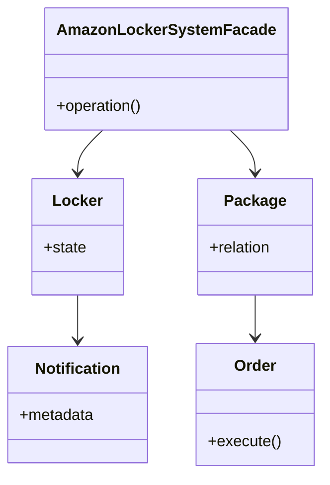

# 🏆 Coach Answer: Amazon Locker — LLD

> **Type:** Low-Level Design
> **Difficulty:** Intermediate
> **Time Target:** 45 minutes

---

This is a coach wrapper. The full canonical answer and interview progression for the Amazon Locker LLD project can be found in the authoritative project directory:

**[Canonical Amazon Locker Answer](../02-lld-projects/amazon-locker/STRONG-ANSWER.md)**

Please refer to the link above for the complete breakdown, including:
- 45-minute pacing and interview narrative.
- Entity modeling, data structure rationales, and design pattern justifications.
- Concurrency defenses, including concurrent barrier-start contention strategies.
- Failure handling, idempotency, and edge cases.
- Reference contracts matching Java and Python implementations.
- Version-specific feature deltas (v1, v2, v3).

## 1. Introduction and Requirements Clarification (5 mins)
**Say:** "To design the Amazon Locker system, I'll start by clarifying the core functional and non-functional requirements specific to Amazon Locker. We must ensure the system handles dynamic locker allocation, concurrent delivery attempts, and reliable state tracking."

**Explicit Clarifications:**
- Clarification 1: Core functionality handling package assignments, locker states, and pickup codes.
- Clarification 2: Extensibility for different locker sizes, return flows, and notification mechanisms.
- Clarification 3: Concurrency handling for multiple packages being processed simultaneously by different drivers.

## 2. Entity Modeling and APIs (10 mins)
**Say:** "The primary entities in this Amazon Locker system encapsulate our business rules, ensuring a clear separation of core concerns."

### Core Entities:
- `Locker`: Represents the physical locker, tracking its size, availability, and access codes.
- `Package`: Represents the item being stored, associating it with a size and a customer.
- `Order`: Manages the overarching process of receiving a package and assigning it to a suitable locker.
- `Notification`: Handles sending SMS or email alerts to customers with pickup instructions.

### Primary APIs:
- `assignLocker(package)`: Core business logic to find an optimal available locker and transition its state to OCCUPIED.
- `pickupPackage(code)`: Validates the user's access code and transitions the locker state back to AVAILABLE.

## 3. Design Alternatives and Trade-offs (10 mins)
**Say:** "Choosing the right data structures and concurrency mechanisms is critical for meeting the latency and scale requirements of this Amazon Locker system."

- **Trade-off 1:** Pre-allocation vs Lazy allocation.
- **Trade-off 2:** Database lookup vs In-memory map.

## 4. Correctness, Complexity, and Concurrency (10 mins)
**Say:** "A single-threaded design fails in production when multiple actions occur simultaneously. We must guarantee deterministic, thread-safe behavior for Amazon Locker."

**Concurrency Mechanisms:**
- Concurrent barrier-start contention strategies when multiple packages arrive simultaneously.
- Concurrency notes: Using row-level locking on the locker table to prevent two drivers from claiming the same locker simultaneously.

## 5. Failure Handling and Edge Cases (10 mins)
**Say:** "We must ensure robust invariants during Amazon Locker edge case scenarios."

**Concrete Failure/Concurrency Discussion:**
- Ensuring retried delivery requests don't assign multiple lockers to the same package.
- Reverting locker status to AVAILABLE if the notification service fails to send the pickup code.

## Class Diagram

## Patterns

- Singleton Pattern for the central locker allocation manager.
- Strategy Pattern for different locker selection algorithms (e.g., closest to entrance vs random).
- Factory Pattern for creating different types of notifications (SMS, Email, Push).

## Concurrency Notes

- Concurrent barrier-start contention strategies when multiple packages arrive simultaneously.
- ConcurrentHashMaps are leveraged to map active access codes to physical lockers.

## Follow-Ups

1. **Follow-Up 1:** How would you scale the Amazon Locker system to manage concurrent reservations across thousands of locker locations during peak holiday seasons?
2. **Follow-Up 2:** What if the Amazon Locker reservation database experiences an outage while customers are actively trying to retrieve their packages?

## Links to Implementations

- [Java Implementation](../02-lld-projects/amazon-locker/java)
- [Python Implementation](../02-lld-projects/amazon-locker/python)

## Detailed System Requirements

1. Lockers come in different sizes (Small, Medium, Large).
2. Packages must be assigned to a locker that is equal to or larger than the package size.
3. Once a package is placed in a locker, the user receives an access code.
4. The user has a limited time to pick up the package before it is returned.
5. Lockers must securely track their state (Open, Closed, Occupied, Empty).
6. The system must handle real-time status updates and notifications.

## Data Structure Deep Dive

When mapping packages to lockers, a naive approach would scan all lockers. A more efficient design uses categorized queues or free lists partitioned by locker size. When a package arrives, the system pops an available locker from the appropriately sized queue in O(1) time. For lookups, maintaining a hash map from access code to locker ID ensures O(1) retrieval when a customer arrives to pick up their package.

## Additional Edge Cases

- **Expired Packages:** Implementing a background cron job to identify and process packages that have exceeded their pickup window.
- **Hardware Failures:** Handling scenarios where a locker's physical lock jams or sensors fail, requiring fallback states.
- **Code Collision:** Ensuring access codes are cryptographically secure and unique across active orders.

