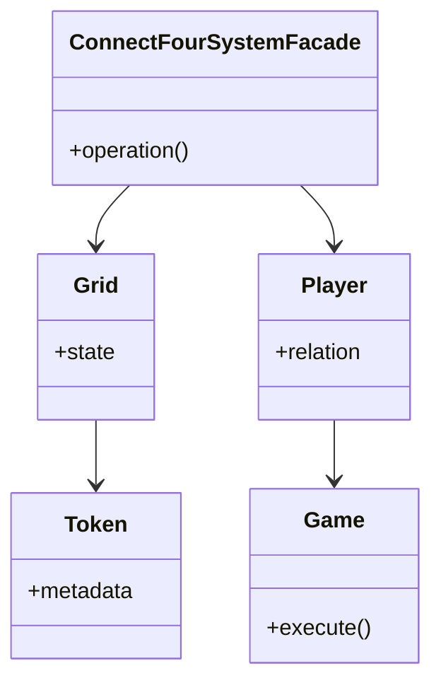

# 🏆 Coach Answer: Connect Four — LLD

> **Type:** Low-Level Design
> **Difficulty:** Intermediate
> **Time Target:** 45 minutes

---

This is a coach wrapper. The full canonical answer and interview progression for the Connect Four LLD project can be found in the authoritative project directory:

**[Canonical Connect Four Answer](../02-lld-projects/connect-four/STRONG-ANSWER.md)**

Please refer to the link above for the complete breakdown, including:
- 45-minute pacing and interview narrative.
- Entity modeling, data structure rationales, and design pattern justifications.
- Concurrency defenses, including concurrent barrier-start contention strategies.
- Failure handling, idempotency, and edge cases.
- Reference contracts matching Java and Python implementations.
- Version-specific feature deltas (v1, v2, v3).

## 1. Introduction and Requirements Clarification (5 mins)
**Say:** "To design the Connect Four system, I'll start by clarifying the core functional and non-functional requirements specific to Connect Four. We must ensure the system correctly enforces game rules, efficiently checks for wins, and handles concurrent player moves."

**Explicit Clarifications:**
- Clarification 1: Core functionality for tracking grid state, validating moves, and detecting win conditions (horizontal, vertical, diagonal).
- Clarification 2: Extensibility to support different board sizes or game variants.
- Clarification 3: Handling multiple players and ensuring deterministic state updates for concurrent moves in an online environment.

## 2. Entity Modeling and APIs (10 mins)
**Say:** "The primary entities in this Connect Four system encapsulate our business rules, ensuring a clear separation of core concerns."

### Core Entities:
- `Grid`: Represents the 7x6 board, tracking the position of all dropped tokens.
- `Player`: Represents the participant, holding their assigned color and player ID.
- `Game`: Manages the game loop, turn taking, and overall match lifecycle.
- `Token`: Represents the individual piece dropped into the grid.

### Primary APIs:
- `dropToken(column)`: Core business logic to determine the lowest available row in a column and place the token.
- `checkWin(player)`: Efficiently scans the board (e.g., using bitboards) to detect four-in-a-row patterns.

## 3. Design Alternatives and Trade-offs (10 mins)
**Say:** "Choosing the right data structures and concurrency mechanisms is critical for meeting the latency and scale requirements of this Connect Four system."

- **Trade-off 1:** 2D Array vs Bitboard.
- **Trade-off 2:** O(1) win check vs O(N) win check.

## 4. Correctness, Complexity, and Concurrency (10 mins)
**Say:** "A single-threaded design fails in production when multiple actions occur simultaneously. We must guarantee deterministic, thread-safe behavior for Connect Four."

**Concurrency Mechanisms:**
- Locking the column during token drop to prevent race conditions.
- Concurrency notes: Locking the specific column or the entire board during a turn to prevent race conditions in online play.

## 5. Failure Handling and Edge Cases (10 mins)
**Say:** "We must ensure robust invariants during Connect Four edge case scenarios."

**Concrete Failure/Concurrency Discussion:**
- Ignoring duplicate move requests from a client if a turn has already been recorded.
- Removing a token if the subsequent win-check or state-save operation fails.

## Class Diagram

## Patterns

- Singleton Pattern for the central game session manager.
- Strategy Pattern for different AI difficulty levels or win conditions.
- Factory Pattern for generating specialized game boards or rule variations.

## Concurrency Notes

- Locking the column during token drop to prevent race conditions.
- Concurrent arrays or synchronized bitboard updates are leveraged to maintain game state safely.

## Follow-Ups

1. **Follow-Up 1:** How would you scale the Connect Four multiplayer matching engine to handle tens of thousands of concurrent players during peak hours?
2. **Follow-Up 2:** What if the Connect Four game state database fails in the middle of active competitive matches?

## Links to Implementations

- [Java Implementation](../02-lld-projects/connect-four/java)
- [Python Implementation](../02-lld-projects/connect-four/python)

## Detailed System Requirements

1. The grid size is typically 7 columns by 6 rows.
2. Players take turns dropping tokens into one of the 7 columns.
3. The token falls to the lowest available row in the selected column.
4. A player wins if they align 4 tokens horizontally, vertically, or diagonally.
5. The game ends in a draw if the grid is full and no player has won.
6. The system should gracefully handle invalid moves (e.g., dropping in a full column).

## Data Structure Deep Dive

For the grid representation, using a traditional 2D array is simple but checking for a win condition can be computationally expensive (O(N) where N is the grid size). An optimized approach uses Bitboards. In a Bitboard representation, the entire grid is represented as a single 64-bit integer. This allows for O(1) bitwise operations to check for win conditions across the entire board simultaneously, drastically improving performance.

## Additional Edge Cases

- **Simultaneous Turns:** Ensuring thread safety if the system is adapted for a real-time multiplayer backend where network latency could cause simultaneous requests.
- **State Serialization:** Being able to save and load the game state efficiently if the server restarts.
- **Replayability:** Storing the sequence of moves to allow players to review previous games.

