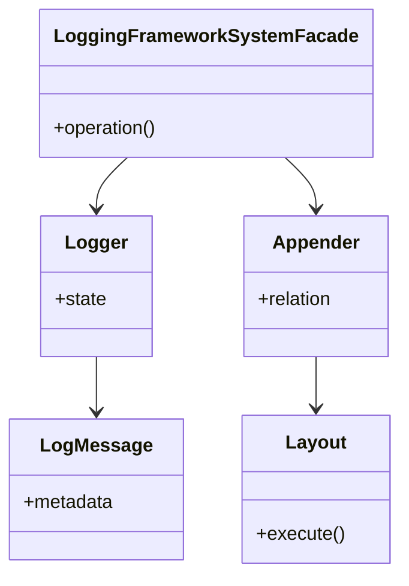

# 🏆 Coach Answer: Logging Framework — LLD

> **Type:** Low-Level Design
> **Difficulty:** Intermediate
> **Time Target:** 45 minutes

---

This is a coach wrapper. The full canonical answer and interview progression for the Logging Framework LLD project can be found in the authoritative project directory:

**[Canonical Logging Framework Answer](../02-lld-projects/logging-framework/STRONG-ANSWER.md)**

Please refer to the link above for the complete breakdown, including:
- 45-minute pacing and interview narrative.
- Entity modeling, data structure rationales, and design pattern justifications.
- Concurrency defenses, including concurrent barrier-start contention strategies.
- Failure handling, idempotency, and edge cases.
- Reference contracts matching Java and Python implementations.
- Version-specific feature deltas (v1, v2, v3).

## 1. Introduction and Requirements Clarification (5 mins)
**Say:** "To design the Logging Framework system, I'll start by clarifying the core functional and non-functional requirements specific to Logging Framework. We must ensure the framework is non-blocking, highly configurable, and guarantees message delivery without slowing down the host application."

**Explicit Clarifications:**
- Clarification 1: Core functionality for message formatting, log levels, and destination routing.
- Clarification 2: Extensibility for adding new appenders (file, console, network) and custom log formats.
- Clarification 3: Scale and concurrency handling to ensure non-blocking, asynchronous logging under heavy application load.

## 2. Entity Modeling and APIs (10 mins)
**Say:** "The primary entities in this Logging Framework system encapsulate our business rules, ensuring a clear separation of core concerns."

### Core Entities:
- `Logger`: The primary interface used by applications to submit log entries at various severity levels.
- `Appender`: Defines the destination for the log messages, such as a file, database, or console.
- `Layout`: Determines the formatting and structure (e.g., JSON, plain text) of the final log output.
- `LogMessage`: Encapsulates the raw log data, timestamp, thread ID, and metadata.

### Primary APIs:
- `log(level, message)`: Asynchronously adds the message to a high-performance concurrent queue.
- `addAppender(appender)`: Dynamically attaches new output destinations to the logger at runtime.

## 3. Design Alternatives and Trade-offs (10 mins)
**Say:** "Choosing the right data structures and concurrency mechanisms is critical for meeting the latency and scale requirements of this Logging Framework system."

- **Trade-off 1:** Synchronous vs Asynchronous logging.
- **Trade-off 2:** Rolling file vs Single file.

## 4. Correctness, Complexity, and Concurrency (10 mins)
**Say:** "A single-threaded design fails in production when multiple actions occur simultaneously. We must guarantee deterministic, thread-safe behavior for Logging Framework."

**Concurrency Mechanisms:**
- Using blocking queues and worker threads for async logging to unblock the main thread.
- Concurrency notes: Using lock-free data structures like ring buffers to handle high-throughput log ingestion.

## 5. Failure Handling and Edge Cases (10 mins)
**Say:** "We must ensure robust invariants during Logging Framework edge case scenarios."

**Concrete Failure/Concurrency Discussion:**
- Ensuring identical log messages in rapid succession are correctly processed or throttled if configured.
- Dropping messages or falling back to a secondary appender if the primary disk write fails.

## Class Diagram

## Patterns

- Singleton Pattern for the central LoggerManager context.
- Strategy Pattern for dynamically swapping formatting layouts or rolling policies.
- Factory Pattern for instantiating different types of appenders based on configuration.

## Concurrency Notes

- Using blocking queues and worker threads for async logging to unblock the main thread.
- Concurrent queues (like Disruptor or LinkedBlockingQueue) are leveraged across the ingestion layer.

## Follow-Ups

1. **Follow-Up 1:** How would you scale the Logging Framework to process and index terabytes of log data per minute without blocking the main application thread?
2. **Follow-Up 2:** What if the Logging Framework's downstream storage backend becomes unavailable while applications are heavily emitting logs?

## Links to Implementations

- [Java Implementation](../02-lld-projects/logging-framework/java)
- [Python Implementation](../02-lld-projects/logging-framework/python)

## Detailed System Requirements

1. Support different log levels (TRACE, DEBUG, INFO, WARN, ERROR, FATAL).
2. Allow configuring log outputs to multiple destinations (Console, File, Network).
3. Support custom message formatting (JSON, Plain Text).
4. The framework must not block the application's main thread significantly.
5. Support log rolling based on file size or date.
6. Provide a way to filter logs dynamically at runtime.

## Data Structure Deep Dive

For high-throughput applications, asynchronous logging is crucial. The core data structure is often a highly optimized concurrent queue (e.g., LMAX Disruptor or a lock-free Ring Buffer). When the application calls `log()`, the message is rapidly appended to this queue. A dedicated background thread then consumes from this queue, formats the message, and writes it to the slow I/O destination, ensuring the main application thread experiences microsecond latency.

## Additional Edge Cases

- **Queue Overflow:** Handling backpressure when the disk is slow and the queue fills up (Drop messages? Block caller?).
- **Shutdown Hooks:** Ensuring the queue is gracefully flushed to disk before the application terminates.
- **Configuration Hot-Reloading:** Applying changes to log levels dynamically without restarting the application.

