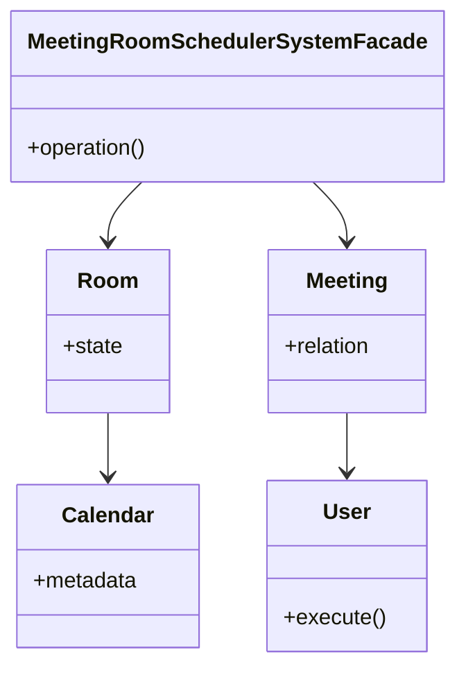

# 🏆 Coach Answer: Meeting Room Scheduler — LLD

> **Type:** Low-Level Design
> **Difficulty:** Intermediate
> **Time Target:** 45 minutes

---

This is a coach wrapper. The full canonical answer and interview progression for the Meeting Room Scheduler LLD project can be found in the authoritative project directory:

**[Canonical Meeting Room Scheduler Answer](../02-lld-projects/meeting-room-scheduler/STRONG-ANSWER.md)**

Please refer to the link above for the complete breakdown, including:
- 45-minute pacing and interview narrative.
- Entity modeling, data structure rationales, and design pattern justifications.
- Concurrency defenses, including concurrent barrier-start contention strategies.
- Failure handling, idempotency, and edge cases.
- Reference contracts matching Java and Python implementations.
- Version-specific feature deltas (v1, v2, v3).

## 1. Introduction and Requirements Clarification (5 mins)
**Say:** "To design the Meeting Room Scheduler system, I'll start by clarifying the core functional and non-functional requirements specific to Meeting Room Scheduler. We must ensure the system accurately tracks room availability, handles complex recurring bookings, and prevents scheduling conflicts."

**Explicit Clarifications:**
- Clarification 1: Core functionality for checking room availability, booking time slots, and handling conflicts.
- Clarification 2: Extensibility for recurring meetings, different room capacities, and notification systems.
- Clarification 3: Scale and concurrency handling to prevent double-booking during simultaneous reservation requests.

## 2. Entity Modeling and APIs (10 mins)
**Say:** "The primary entities in this Meeting Room Scheduler system encapsulate our business rules, ensuring a clear separation of core concerns."

### Core Entities:
- `Room`: Represents the physical meeting space, including capacity and available equipment.
- `Meeting`: Represents a specific reserved time block for a given room.
- `User`: Manages the overall calendar, processing incoming requests and coordinating notifications.
- `Calendar`: Represents the individual or team initiating the reservation.

### Primary APIs:
- `bookRoom(time, duration)`: Core logic to validate availability and create a new reservation record.
- `checkAvailability(time)`: Frees up the reserved time slot and notifies waitlisted users.

## 3. Design Alternatives and Trade-offs (10 mins)
**Say:** "Choosing the right data structures and concurrency mechanisms is critical for meeting the latency and scale requirements of this Meeting Room Scheduler system."

- **Trade-off 1:** Interval Tree vs List of Intervals.
- **Trade-off 2:** Eager overlap check vs Lazy overlap check.

## 4. Correctness, Complexity, and Concurrency (10 mins)
**Say:** "A single-threaded design fails in production when multiple actions occur simultaneously. We must guarantee deterministic, thread-safe behavior for Meeting Room Scheduler."

**Concurrency Mechanisms:**
- Handling concurrent booking requests for the same room and time slot using optimistic locking.
- Concurrency notes: Using database constraints or distributed locks to prevent double-booking the same room for overlapping times.

## 5. Failure Handling and Edge Cases (10 mins)
**Say:** "We must ensure robust invariants during Meeting Room Scheduler edge case scenarios."

**Concrete Failure/Concurrency Discussion:**
- Ensuring a retried booking request doesn't result in two identical reservations.
- Releasing the temporary hold on a room if the final calendar sync fails.

## Class Diagram

## Patterns

- Singleton Pattern for the central calendar scheduling service.
- Strategy Pattern for different conflict resolution or room recommendation algorithms.
- Factory Pattern for creating different types of recurring meeting schedules.

## Concurrency Notes

- Handling concurrent booking requests for the same room and time slot using optimistic locking.
- Thread-safe interval trees or synchronized maps are leveraged for conflict resolution.

## Follow-Ups

1. **Follow-Up 1:** How would you scale the Meeting Room Scheduler to handle high concurrency during morning rush hours when employees are booking rooms simultaneously?
2. **Follow-Up 2:** What if the Meeting Room Scheduler's primary database fails and a secondary database must take over without losing recent reservations?

## Links to Implementations

- [Java Implementation](../02-lld-projects/meeting-room-scheduler/java)
- [Python Implementation](../02-lld-projects/meeting-room-scheduler/python)

## Detailed System Requirements

1. Users can view available rooms for a given time slot.
2. Users can book a room for a specific duration.
3. Rooms have varying capacities and amenities (Projector, Whiteboard).
4. Users can cancel existing bookings.
5. The system must strictly prevent double booking of any room.
6. Support for recurring meetings.

## Data Structure Deep Dive

To efficiently query room availability across a timeline, an Interval Tree or a Segment Tree is the optimal data structure. While a simple list of intervals requires O(N) to check for overlaps, an Interval Tree can find all overlapping meetings in O(log N + k) time. For database persistence, range queries or PostGIS range types can push this complexity down to the storage layer.

## Additional Edge Cases

- **Daylight Saving Time:** Handling timezone shifts and recurring meetings across DST boundaries.
- **Partial Cancellations:** Modifying a single occurrence of a recurring meeting series.
- **Resource Contention:** Mitigating the "thundering herd" problem when a highly desirable room becomes available.

