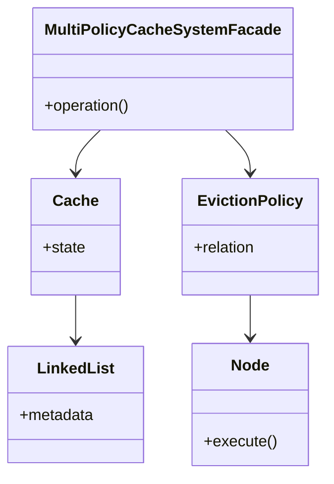

# 🏆 Coach Answer: Multi Policy Cache — LLD

> **Type:** Low-Level Design
> **Difficulty:** Intermediate
> **Time Target:** 45 minutes

---

This is a coach wrapper. The full canonical answer and interview progression for the Multi Policy Cache LLD project can be found in the authoritative project directory:

**[Canonical Multi Policy Cache Answer](../02-lld-projects/multi-policy-cache/STRONG-ANSWER.md)**

Please refer to the link above for the complete breakdown, including:
- 45-minute pacing and interview narrative.
- Entity modeling, data structure rationales, and design pattern justifications.
- Concurrency defenses, including concurrent barrier-start contention strategies.
- Failure handling, idempotency, and edge cases.
- Reference contracts matching Java and Python implementations.
- Version-specific feature deltas (v1, v2, v3).

## 1. Introduction and Requirements Clarification (5 mins)
**Say:** "To design the Multi Policy Cache system, I'll start by clarifying the core functional and non-functional requirements specific to Multi Policy Cache. We must ensure the cache maintains high hit rates, enforces memory bounds strictly, and handles concurrent access efficiently."

**Explicit Clarifications:**
- Clarification 1: Core functionality for storing and retrieving key-value pairs with bounded capacity.
- Clarification 2: Extensibility to support multiple swappable eviction policies (e.g., LRU, LFU, FIFO).
- Clarification 3: Concurrency handling to ensure thread-safe reads and writes without significant performance bottlenecks.

## 2. Entity Modeling and APIs (10 mins)
**Say:** "The primary entities in this Multi Policy Cache system encapsulate our business rules, ensuring a clear separation of core concerns."

### Core Entities:
- `Cache`: The main key-value store interface managing data access and capacity.
- `EvictionPolicy`: The algorithm (LRU, LFU, etc.) dictating which items are removed when capacity is reached.
- `Node`: Represents the individual cached item, containing the key, value, and metadata like access frequency.
- `LinkedList`: The internal data structure used to maintain the eviction order.

### Primary APIs:
- `put(key, value)`: Inserts or updates a value, potentially triggering an eviction if the cache is full.
- `get(key)`: Retrieves a value and updates its position or frequency in the eviction tracking structure.

## 3. Design Alternatives and Trade-offs (10 mins)
**Say:** "Choosing the right data structures and concurrency mechanisms is critical for meeting the latency and scale requirements of this Multi Policy Cache system."

- **Trade-off 1:** LRU vs LFU.
- **Trade-off 2:** HashMap+LinkedList vs TreeMap.

## 4. Correctness, Complexity, and Concurrency (10 mins)
**Say:** "A single-threaded design fails in production when multiple actions occur simultaneously. We must guarantee deterministic, thread-safe behavior for Multi Policy Cache."

**Concurrency Mechanisms:**
- ReadWriteLocks or ConcurrentHashMap for thread-safe cache access.
- Concurrency notes: Using ReadWrite locks or ConcurrentHashMap to allow multiple readers while safely isolating writes.

## 5. Failure Handling and Edge Cases (10 mins)
**Say:** "We must ensure robust invariants during Multi Policy Cache edge case scenarios."

**Concrete Failure/Concurrency Discussion:**
- Ensuring concurrent put requests for the same key resolve to a consistent final state.
- Reverting eviction tracking pointers if the actual data removal fails.

## Class Diagram

## Patterns

- Singleton Pattern for the global cache manager instance.
- Strategy Pattern for dynamically switching between LRU, LFU, or FIFO eviction policies.
- Factory Pattern for constructing the appropriate internal data structures based on the chosen policy.

## Concurrency Notes

- ReadWriteLocks or ConcurrentHashMap for thread-safe cache access.
- ConcurrentHashMaps combined with locked doubly-linked lists are leveraged across the caching layer.

## Follow-Ups

1. **Follow-Up 1:** How would you scale the Multi Policy Cache to maintain low latency eviction policies across a distributed cluster with high read/write throughput?
2. **Follow-Up 2:** What if the Multi Policy Cache's backing datastore goes down and the cache must handle a thundering herd of cache misses?

## Links to Implementations

- [Java Implementation](../02-lld-projects/multi-policy-cache/java)
- [Python Implementation](../02-lld-projects/multi-policy-cache/python)

## Detailed System Requirements

1. The cache must adhere to a strict capacity limit.
2. When the capacity is reached, an item must be evicted based on a defined policy.
3. Support for multiple eviction policies (LRU, LFU, FIFO).
4. Both `get` and `put` operations must execute in O(1) time complexity.
5. The system must be thread-safe for highly concurrent environments.
6. The eviction policy should be swappable at runtime.

## Data Structure Deep Dive

For an LRU (Least Recently Used) cache, the standard combination is a HashMap paired with a Doubly Linked List. The HashMap provides O(1) lookups, while the Linked List maintains the temporal ordering. When an item is accessed, it is moved to the head of the list in O(1) time. For LFU (Least Frequently Used), a more complex structure involving a HashMap of frequencies mapped to Linked Lists is required to maintain O(1) performance.

## Additional Edge Cases

- **Cache Stampede:** Preventing a scenario where multiple threads miss the cache simultaneously and overwhelm the backing database.
- **Memory Leaks:** Ensuring that evicted nodes are properly dereferenced for garbage collection.
- **Stale Data:** Implementing a Time-To-Live (TTL) mechanism alongside the eviction policy.

