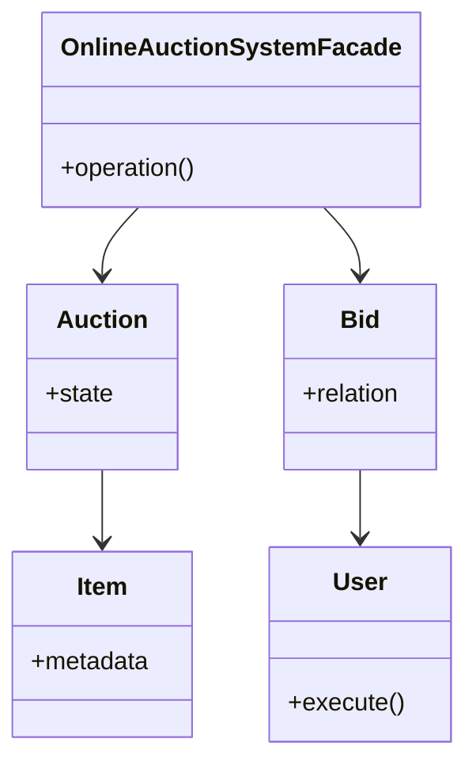

# 🏆 Coach Answer: Online Auction — LLD

> **Type:** Low-Level Design
> **Difficulty:** Intermediate
> **Time Target:** 45 minutes

---

This is a coach wrapper. The full canonical answer and interview progression for the Online Auction LLD project can be found in the authoritative project directory:

**[Canonical Online Auction Answer](../02-lld-projects/online-auction/STRONG-ANSWER.md)**

Please refer to the link above for the complete breakdown, including:
- 45-minute pacing and interview narrative.
- Entity modeling, data structure rationales, and design pattern justifications.
- Concurrency defenses, including concurrent barrier-start contention strategies.
- Failure handling, idempotency, and edge cases.
- Reference contracts matching Java and Python implementations.
- Version-specific feature deltas (v1, v2, v3).

## 1. Introduction and Requirements Clarification (5 mins)
**Say:** "To design the Online Auction system, I'll start by clarifying the core functional and non-functional requirements specific to Online Auction. We must ensure the system accurately tracks real-time bids, enforces auction deadlines, and guarantees fair outcomes."

**Explicit Clarifications:**
- Clarification 1: Core functionality for accepting bids, tracking the highest bidder, and determining the winner when the auction ends.
- Clarification 2: Extensibility for different auction types (e.g., English, Vickrey) and notification integrations.
- Clarification 3: Concurrency handling to process high-volume, simultaneous bids during the final seconds of an auction.

## 2. Entity Modeling and APIs (10 mins)
**Say:** "The primary entities in this Online Auction system encapsulate our business rules, ensuring a clear separation of core concerns."

### Core Entities:
- `Auction`: Represents the item being sold, tracking its current highest bid and expiration time.
- `Bid`: Represents an individual financial offer made by a user for a specific item.
- `User`: Manages the lifecycle of multiple auctions, coordinating state changes and validations.
- `Item`: Represents the participant placing bids on items.

### Primary APIs:
- `placeBid(auctionId, amount)`: Validates the offer amount against current bids and updates the leading position.
- `closeAuction(auctionId)`: Finalizes the auction, determining the winner and initiating payment processes.

## 3. Design Alternatives and Trade-offs (10 mins)
**Say:** "Choosing the right data structures and concurrency mechanisms is critical for meeting the latency and scale requirements of this Online Auction system."

- **Trade-off 1:** Real-time updates via WebSockets vs Polling.
- **Trade-off 2:** Event Sourcing vs State mutation.

## 4. Correctness, Complexity, and Concurrency (10 mins)
**Say:** "A single-threaded design fails in production when multiple actions occur simultaneously. We must guarantee deterministic, thread-safe behavior for Online Auction."

**Concurrency Mechanisms:**
- Preventing race conditions when multiple users bid simultaneously using atomic compare-and-swap.
- Concurrency notes: Using optimistic concurrency control (e.g., version numbers) to handle rapid, conflicting bids on the same item.

## 5. Failure Handling and Edge Cases (10 mins)
**Say:** "We must ensure robust invariants during Online Auction edge case scenarios."

**Concrete Failure/Concurrency Discussion:**
- Ensuring network retries don't result in a user accidentally bidding against themselves.
- Reverting the highest bid status if the subsequent payment authorization hold fails.

## Class Diagram

## Patterns

- Singleton Pattern for the core auction lifecycle manager.
- Strategy Pattern for different pricing models (e.g., English vs Vickrey auctions).
- Factory Pattern for generating different types of bid validation rules.

## Concurrency Notes

- Preventing race conditions when multiple users bid simultaneously using atomic compare-and-swap.
- Thread-safe data structures are leveraged to manage the priority queue of incoming bids.

## Follow-Ups

1. **Follow-Up 1:** How would you scale the Online Auction system to handle massive spikes in bidding activity during the final seconds of high-profile item auctions?
2. **Follow-Up 2:** What if the Online Auction database goes down during the critical final moments of an auction, preventing bids from being recorded?

## Links to Implementations

- [Java Implementation](../02-lld-projects/online-auction/java)
- [Python Implementation](../02-lld-projects/online-auction/python)

## Detailed System Requirements

1. Sellers can list items for auction with a starting price and end time.
2. Buyers can place bids on active auctions.
3. Bids must be strictly greater than the current highest bid.
4. Users should receive real-time updates when outbid.
5. The auction must close exactly at the specified end time.
6. The system must handle high volume bidding in the final seconds (sniper effect).

## Data Structure Deep Dive

To maintain the ledger of bids, an Event Sourcing pattern is highly effective. Instead of just updating a "current_price" row, every bid is stored as an immutable event in an append-only log. The current state is a projection of these events. This ensures complete auditability and makes it easy to resolve disputes. For fast validation, an in-memory Redis cluster can track the current highest bid.

## Additional Edge Cases

- **Network Latency:** Handling bids that are placed before the deadline but arrive at the server slightly after.
- **Bid Sniping:** Implementing soft-close features (extending the auction by 5 minutes if a bid is placed in the last minute).
- **Payment Authorization:** Reserving funds on the bidder's card to ensure they can pay if they win.

