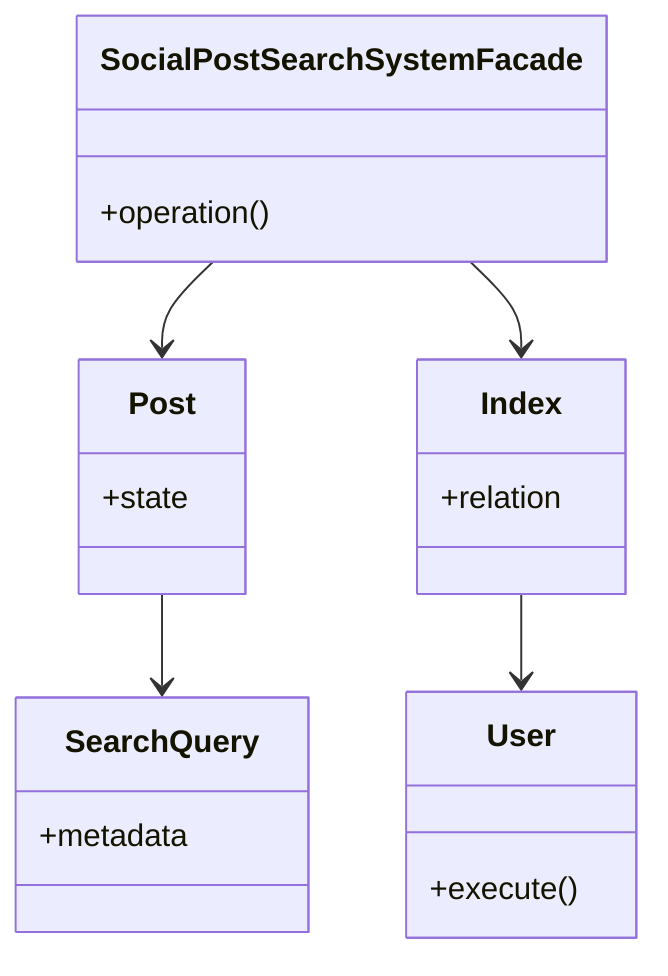

# 🏆 Coach Answer: Social Post Search — LLD

> **Type:** Low-Level Design
> **Difficulty:** Intermediate
> **Time Target:** 45 minutes

---

This is a coach wrapper. The full canonical answer and interview progression for the Social Post Search LLD project can be found in the authoritative project directory:

**[Canonical Social Post Search Answer](../02-lld-projects/social-post-search/STRONG-ANSWER.md)**

Please refer to the link above for the complete breakdown, including:
- 45-minute pacing and interview narrative.
- Entity modeling, data structure rationales, and design pattern justifications.
- Concurrency defenses, including concurrent barrier-start contention strategies.
- Failure handling, idempotency, and edge cases.
- Reference contracts matching Java and Python implementations.
- Version-specific feature deltas (v1, v2, v3).

## 1. Introduction and Requirements Clarification (5 mins)
**Say:** "To design the Social Post Search system, I'll start by clarifying the core functional and non-functional requirements specific to Social Post Search. We must ensure the system provides sub-second query responses, handles massive indexing throughput, and maintains relevance ranking."

**Explicit Clarifications:**
- Clarification 1: Core functionality for indexing post content, processing search queries, and ranking results.
- Clarification 2: Extensibility for supporting boolean queries, ranking algorithms (like BM25), and filtering.
- Clarification 3: Scale and concurrency handling for near-real-time index updates without blocking search queries.

## 2. Entity Modeling and APIs (10 mins)
**Say:** "The primary entities in this Social Post Search system encapsulate our business rules, ensuring a clear separation of core concerns."

### Core Entities:
- `Post`: Represents the user-generated content, including text, author, and timestamp.
- `Index`: The data structure (e.g., Inverted Index) mapping search terms to the posts that contain them.
- `User`: Represents the account searching for or creating content.
- `SearchQuery`: Encapsulates the search string, filters, and pagination parameters.

### Primary APIs:
- `indexPost(post)`: Tokenizes the post content and updates the relevant entries in the inverted index.
- `search(query)`: Executes the search against the index and applies ranking algorithms to the results.

## 3. Design Alternatives and Trade-offs (10 mins)
**Say:** "Choosing the right data structures and concurrency mechanisms is critical for meeting the latency and scale requirements of this Social Post Search system."

- **Trade-off 1:** Inverted Index vs Trie.
- **Trade-off 2:** Real-time indexing vs Batch indexing.

## 4. Correctness, Complexity, and Concurrency (10 mins)
**Say:** "A single-threaded design fails in production when multiple actions occur simultaneously. We must guarantee deterministic, thread-safe behavior for Social Post Search."

**Concurrency Mechanisms:**
- Handling concurrent writes to the search index while serving reads.
- Concurrency notes: Utilizing read-copy-update (RCU) or immutable segment merging to allow lock-free reads during indexing.

## 5. Failure Handling and Edge Cases (10 mins)
**Say:** "We must ensure robust invariants during Social Post Search edge case scenarios."

**Concrete Failure/Concurrency Discussion:**
- Ensuring the same post processed twice doesn't result in duplicate index entries.
- Removing partially indexed terms if the full document processing fails.

## Class Diagram

## Patterns

- Singleton Pattern for the global search index coordinator.
- Strategy Pattern for applying different ranking algorithms like BM25 or TF-IDF.
- Factory Pattern for instantiating specific tokenizers and stemmers based on language.

## Concurrency Notes

- Handling concurrent writes to the search index while serving reads.
- Concurrent structures (e.g., SkipLists) are leveraged to handle near real-time index merges.

## Follow-Ups

1. **Follow-Up 1:** How would you scale the Social Post Search system to provide real-time search results across millions of newly created posts per minute?
2. **Follow-Up 2:** What if the Social Post Search indexing infrastructure fails, causing search results to become stale?

## Links to Implementations

- [Java Implementation](../02-lld-projects/social-post-search/java)
- [Python Implementation](../02-lld-projects/social-post-search/python)

## Detailed System Requirements

1. Users can search for posts using keywords.
2. The search results should be ranked by relevance and recency.
3. New posts should appear in search results with low latency (near real-time).
4. The system must support prefix matching and typo tolerance.
5. The dataset is massive and distributed across multiple nodes.
6. Support for filtering by tags, date ranges, and authors.

## Data Structure Deep Dive

The core engine relies on an Inverted Index, which maps terms (words) to the documents (posts) that contain them. To support prefix matching, a Trie (Prefix Tree) or a Finite State Transducer (FST) is layered on top of the dictionary. For near real-time search, the system uses a combination of an immutable disk-based index and a mutable in-memory buffer for the newest posts, querying both and merging results.

## Additional Edge Cases

- **Stop Words:** Filtering out common words (e.g., "the", "and") to keep index sizes manageable.
- **Sharding Strategy:** Distributing the index across servers based on document ID or time-based indices to handle scale.
- **Ranking Drift:** Ensuring the scoring algorithm (like TF-IDF or BM25) performs consistently as the corpus grows.

