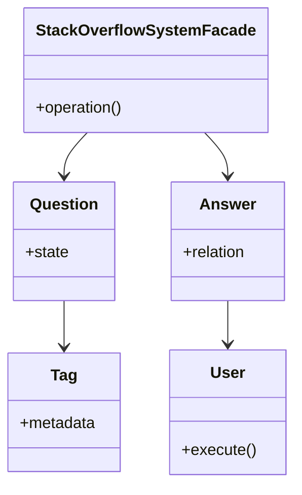

# 🏆 Coach Answer: Stack Overflow — LLD

> **Type:** Low-Level Design
> **Difficulty:** Intermediate
> **Time Target:** 45 minutes

---

This is a coach wrapper. The full canonical answer and interview progression for the Stack Overflow LLD project can be found in the authoritative project directory:

**[Canonical Stack Overflow Answer](../02-lld-projects/stack-overflow/STRONG-ANSWER.md)**

Please refer to the link above for the complete breakdown, including:
- 45-minute pacing and interview narrative.
- Entity modeling, data structure rationales, and design pattern justifications.
- Concurrency defenses, including concurrent barrier-start contention strategies.
- Failure handling, idempotency, and edge cases.
- Reference contracts matching Java and Python implementations.
- Version-specific feature deltas (v1, v2, v3).

## 1. Introduction and Requirements Clarification (5 mins)
**Say:** "To design the Stack Overflow system, I'll start by clarifying the core functional and non-functional requirements specific to Stack Overflow. We must ensure the system handles complex content relationships, tracks reputation accurately, and scales for read-heavy traffic."

**Explicit Clarifications:**
- Clarification 1: Core functionality for posting questions, submitting answers, and voting.
- Clarification 2: Extensibility for reputation systems, tagging, and search integration.
- Clarification 3: Concurrency handling for simultaneous upvotes/downvotes and concurrent edits to the same post.

## 2. Entity Modeling and APIs (10 mins)
**Say:** "The primary entities in this Stack Overflow system encapsulate our business rules, ensuring a clear separation of core concerns."

### Core Entities:
- `Question`: Represents the main inquiry, containing the title, detailed body, and associated tags.
- `Answer`: Represents a user-submitted solution or response to a specific question.
- `User`: Manages user accounts, privileges, and reputation scores.
- `Tag`: Used to categorize content and facilitate discoverability.

### Primary APIs:
- `postQuestion(q)`: Core logic to validate and store a new user-submitted response.
- `vote(item)`: Updates the score of a post and synchronously adjusts the author's reputation.

## 3. Design Alternatives and Trade-offs (10 mins)
**Say:** "Choosing the right data structures and concurrency mechanisms is critical for meeting the latency and scale requirements of this Stack Overflow system."

- **Trade-off 1:** Relational DB vs NoSQL for fast reads.
- **Trade-off 2:** Synchronous reputation update vs Eventual consistency.

## 4. Correctness, Complexity, and Concurrency (10 mins)
**Say:** "A single-threaded design fails in production when multiple actions occur simultaneously. We must guarantee deterministic, thread-safe behavior for Stack Overflow."

**Concurrency Mechanisms:**
- Ensuring vote counts are accurate under heavy concurrent load.
- Concurrency notes: Using optimistic locking to handle scenarios where multiple users attempt to edit the same post simultaneously.

## 5. Failure Handling and Edge Cases (10 mins)
**Say:** "We must ensure robust invariants during Stack Overflow edge case scenarios."

**Concrete Failure/Concurrency Discussion:**
- Ensuring a network retry on a vote doesn't result in double points.
- Reverting reputation changes if the database commit for the vote fails.

## Class Diagram

## Patterns

- Singleton Pattern for the reputation calculation engine.
- Strategy Pattern for different sorting algorithms (e.g., active, hottest, highest voted).
- Factory Pattern for generating different types of notifications (badges, comments, answers).

## Concurrency Notes

- Ensuring vote counts are accurate under heavy concurrent load.
- Thread-safe collections are leveraged across the data layer to handle concurrent vote aggregations.

## Follow-Ups

1. **Follow-Up 1:** How would you scale the Stack Overflow reputation and voting systems to handle high concurrency and prevent abuse during viral questions?
2. **Follow-Up 2:** What if the Stack Overflow database goes down, and how would you ensure users can still view popular questions via read replicas?

## Links to Implementations

- [Java Implementation](../02-lld-projects/stack-overflow/java)
- [Python Implementation](../02-lld-projects/stack-overflow/python)

## Detailed System Requirements

1. Users can post questions with specific tags.
2. Other users can post answers to those questions.
3. Both questions and answers can be upvoted or downvoted.
4. Users earn reputation points based on the votes their content receives.
5. A question author can accept exactly one answer as the correct solution.
6. The system must support rich text formatting and code snippets.

## Data Structure Deep Dive

While a relational database is excellent for the core transactional integrity (Users, Posts, Votes), a highly trafficked read-heavy site requires denormalization. A Document Store (like MongoDB) or a robust caching layer (Memcached/Redis) is used to serve the "Question View," which pre-assembles the question, its top answers, and comments into a single JSON object to minimize database joins on every page load.

## Additional Edge Cases

- **Vote Fraud:** Detecting and nullifying organized voting rings or bot activity.
- **Concurrent Edits:** Handling scenarios where two users attempt to edit the same post simultaneously (Optimistic Concurrency Control).
- **Tag Synonymy:** Merging related tags (e.g., `js` and `javascript`) transparently.

