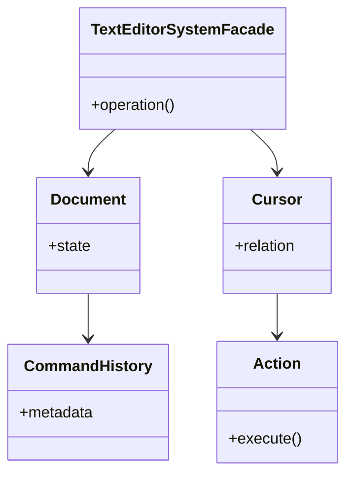

# 🏆 Coach Answer: Text Editor — LLD

> **Type:** Low-Level Design
> **Difficulty:** Intermediate
> **Time Target:** 45 minutes

---

This is a coach wrapper. The full canonical answer and interview progression for the Text Editor LLD project can be found in the authoritative project directory:

**[Canonical Text Editor Answer](../02-lld-projects/text-editor/STRONG-ANSWER.md)**

Please refer to the link above for the complete breakdown, including:
- 45-minute pacing and interview narrative.
- Entity modeling, data structure rationales, and design pattern justifications.
- Concurrency defenses, including concurrent barrier-start contention strategies.
- Failure handling, idempotency, and edge cases.
- Reference contracts matching Java and Python implementations.
- Version-specific feature deltas (v1, v2, v3).

## 1. Introduction and Requirements Clarification (5 mins)
**Say:** "To design the Text Editor system, I'll start by clarifying the core functional and non-functional requirements specific to Text Editor. We must ensure the system provides zero-latency keystroke rendering, handles massive files efficiently, and supports robust undo history."

**Explicit Clarifications:**
- Clarification 1: Core functionality for inserting, deleting, and modifying text efficiently.
- Clarification 2: Extensibility for features like undo/redo, cursor tracking, and search/replace.
- Clarification 3: Performance requirements for handling large documents and potentially collaborative concurrent edits.

## 2. Entity Modeling and APIs (10 mins)
**Say:** "The primary entities in this Text Editor system encapsulate our business rules, ensuring a clear separation of core concerns."

### Core Entities:
- `Document`: The primary data structure (e.g., Gap Buffer or Rope) containing the actual text content.
- `Cursor`: Tracks the current insertion point or selected text range within the document.
- `Action`: Represents a single atomic modification to the document, such as inserting a character.
- `CommandHistory`: Maintains the stack of past actions to enable undo and redo functionality.

### Primary APIs:
- `insert(char)`: Core logic to insert a character at the current cursor position and update the history.
- `undo()`: Pops the last action from the history stack and applies its inverse to the document.

## 3. Design Alternatives and Trade-offs (10 mins)
**Say:** "Choosing the right data structures and concurrency mechanisms is critical for meeting the latency and scale requirements of this Text Editor system."

- **Trade-off 1:** Gap Buffer vs Rope.
- **Trade-off 2:** Command Pattern vs Memento Pattern for Undo.

## 4. Correctness, Complexity, and Concurrency (10 mins)
**Say:** "A single-threaded design fails in production when multiple actions occur simultaneously. We must guarantee deterministic, thread-safe behavior for Text Editor."

**Concurrency Mechanisms:**
- Thread safety during autosave while the user is typing.
- Concurrency notes: Managing thread safety when background tasks like spell check or auto-save access the document model.

## 5. Failure Handling and Edge Cases (10 mins)
**Say:** "We must ensure robust invariants during Text Editor edge case scenarios."

**Concrete Failure/Concurrency Discussion:**
- Ensuring rapid, identical keystroke events are processed in order without duplication errors.
- Reverting partial buffer modifications if a complex search-and-replace operation runs out of memory.

## Class Diagram

## Patterns

- Singleton Pattern for the application window or primary clipboard manager.
- Strategy Pattern for different text rendering engines or syntax highlighting rules.
- Factory Pattern for creating specific command objects for the undo/redo stack.

## Concurrency Notes

- Thread safety during autosave while the user is typing.
- Thread-safe command stacks are leveraged across the data layer for collaborative editing.

## Follow-Ups

1. **Follow-Up 1:** How would you scale the Text Editor's collaborative editing features to support dozens of concurrent users editing the same document in real-time?
2. **Follow-Up 2:** What if the Text Editor's synchronization service goes down while multiple users are actively making un-synced changes to a document?

## Links to Implementations

- [Java Implementation](../02-lld-projects/text-editor/java)
- [Python Implementation](../02-lld-projects/text-editor/python)

## Detailed System Requirements

1. Users can type, delete, and modify text at the cursor position.
2. The system must support infinite Undo and Redo functionality.
3. Operations must be highly responsive with minimal latency, even for large files.
4. Support for copy, paste, and highlighting.
5. Basic syntax highlighting or formatting hooks.
6. File I/O operations (Save, Load) must not freeze the UI.

## Data Structure Deep Dive

For the underlying text representation, simple strings or arrays require O(N) shifts on insertion. A Gap Buffer keeps a contiguous empty space at the cursor, making local edits O(1). However, for multi-megabyte files, a Rope data structure (a binary tree of strings) is superior, allowing O(log N) insertions and deletions anywhere in the document, avoiding massive memory reallocations.

## Additional Edge Cases

- **Undo Stack Overflow:** Managing the memory footprint of the command history for very long editing sessions.
- **Multi-cursor Support:** Extending the model to handle simultaneous edits at different locations in the document.
- **Encoding Issues:** Safely handling UTF-8 multibyte characters and complex grapheme clusters during cursor movement and deletion.

