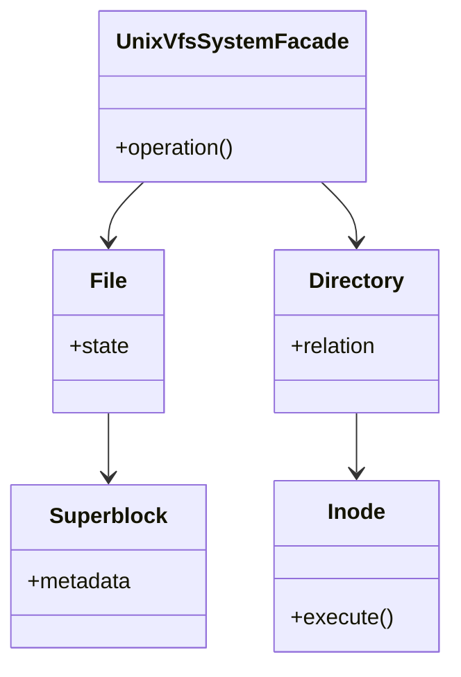

# 🏆 Coach Answer: Unix Vfs — LLD

> **Type:** Low-Level Design
> **Difficulty:** Intermediate
> **Time Target:** 45 minutes

---

This is a coach wrapper. The full canonical answer and interview progression for the Unix Vfs LLD project can be found in the authoritative project directory:

**[Canonical Unix Vfs Answer](../02-lld-projects/unix-vfs/STRONG-ANSWER.md)**

Please refer to the link above for the complete breakdown, including:
- 45-minute pacing and interview narrative.
- Entity modeling, data structure rationales, and design pattern justifications.
- Concurrency defenses, including concurrent barrier-start contention strategies.
- Failure handling, idempotency, and edge cases.
- Reference contracts matching Java and Python implementations.
- Version-specific feature deltas (v1, v2, v3).

## 1. Introduction and Requirements Clarification (5 mins)
**Say:** "To design the Unix Vfs system, I'll start by clarifying the core functional and non-functional requirements specific to Unix Vfs. We must ensure the system correctly resolves complex paths, enforces security permissions, and manages disk space allocation."

**Explicit Clarifications:**
- Clarification 1: Core functionality for file operations (read, write, delete) and directory hierarchy management.
- Clarification 2: Extensibility for permissions, metadata, and different file system types.
- Clarification 3: Concurrency handling for simultaneous read and write operations to the same files or directories.

## 2. Entity Modeling and APIs (10 mins)
**Say:** "The primary entities in this Unix Vfs system encapsulate our business rules, ensuring a clear separation of core concerns."

### Core Entities:
- `File`: Represents an abstract file descriptor providing read/write access to data.
- `Directory`: A specialized file type that maps names to specific inodes within the hierarchy.
- `Inode`: The fundamental metadata record containing permissions, ownership, and data block pointers.
- `Superblock`: Maintains global metadata about the file system, such as total size and free space.

### Primary APIs:
- `mkdir(path)`: Core logic to allocate a new inode, update the parent directory, and create the file entry.
- `open(file)`: Resolves a path to an inode and returns a file descriptor for subsequent operations.

## 3. Design Alternatives and Trade-offs (10 mins)
**Say:** "Choosing the right data structures and concurrency mechanisms is critical for meeting the latency and scale requirements of this Unix Vfs system."

- **Trade-off 1:** Trie vs Hash Map for path resolution.
- **Trade-off 2:** Hard links vs Soft links.

## 4. Correctness, Complexity, and Concurrency (10 mins)
**Say:** "A single-threaded design fails in production when multiple actions occur simultaneously. We must guarantee deterministic, thread-safe behavior for Unix Vfs."

**Concurrency Mechanisms:**
- Directory level locks for concurrent file creation.
- Concurrency notes: Using fine-grained locking on specific inodes to allow concurrent reads while safely serializing writes.

## 5. Failure Handling and Edge Cases (10 mins)
**Say:** "We must ensure robust invariants during Unix Vfs edge case scenarios."

**Concrete Failure/Concurrency Discussion:**
- Ensuring repeated 'mkdir' commands gracefully return an 'already exists' error without corrupting state.
- Freeing newly allocated data blocks if the final inode metadata update fails.

## Class Diagram

## Patterns

- Singleton Pattern for the global virtual file system mount manager.
- Strategy Pattern for interfacing with different underlying file system drivers (ext4, FAT32).
- Factory Pattern for instantiating specific file objects based on their type (regular, socket, device).

## Concurrency Notes

- Directory level locks for concurrent file creation.
- Thread-safe maps are leveraged to manage the global file descriptor table and open file handles.

## Follow-Ups

1. **Follow-Up 1:** How would you scale the Unix VFS architecture to handle highly concurrent file I/O operations and directory traversal in a multi-threaded environment?
2. **Follow-Up 2:** What if the underlying block storage of the Unix VFS becomes temporarily unreachable or corrupted?

## Links to Implementations

- [Java Implementation](../02-lld-projects/unix-vfs/java)
- [Python Implementation](../02-lld-projects/unix-vfs/python)

## Detailed System Requirements

1. The system must model a hierarchical tree of directories and files.
2. Every file and directory is represented by an Inode containing metadata (size, permissions).
3. Support for reading, writing, and appending to files.
4. Support for file links (Hard links and Symlinks).
5. The system must enforce access control based on user permissions.
6. Path resolution must be efficient (e.g., `/usr/local/bin`).

## Data Structure Deep Dive

The core hierarchy is naturally represented as an N-ary tree or a Composite pattern. However, the critical component is the Inode table. To resolve a path like `/a/b/c`, the system traverses the tree. Caching is paramount here. A Dentry (Directory Entry) Cache, typically implemented as a fast Hash Map mapping string paths to Inode references, prevents slow disk lookups during repeated access to the same path.

## Additional Edge Cases

- **Circular Symlinks:** Detecting and breaking infinite loops when resolving symbolic links.
- **Concurrent Deletions:** Handling the case where a file is deleted while another process holds an open file descriptor to it.
- **Disk Fragmentation:** Managing block allocation efficiently to prevent free space fragmentation over time.

